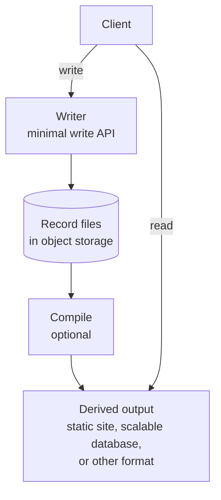
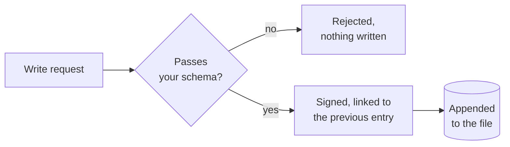

# YafiDB

**A database you can read, diff, and rebuild.**

YafiDB keeps records in plain files—the source of truth—and turns them into whatever a project needs: a static site, a queryable database, or another format. Files stay portable and easy to inspect; derived outputs can be deleted and rebuilt at any time.

> **Status: design stage.** This repository contains the design and examples, not working software. Names and interfaces are illustrative.

**Explore:** [Design overview](docs/design.md) · [Examples](examples/) · [Configuration](docs/configuration.md)

## An example record

Every change is appended to the file, and Yafi adds its own `yafi` line to each one.

```yaml
# order/1042/2026.yaml
yafi: yafi@1
schema: order@1
---
status: placed
customer: { name: Alice, email: alice@example.com }
items:
  - { sku: MUG-01, qty: 2, price: 12.50 }
note: |
  Gift message: "Happy 60th, Mom!" Love, José & Ana 🎉
  Leave at the side door --- not the front (dog #2 bites).
  Sorry it's late :\ wrap it in {blue} paper if you can.
carrierLog: ""
yafi: checkpoint 2026-10-29T15:02:11Z eyJhbGciOiJFZDI1NTE5In0...9fQk2x
---
status: shipped
tracking: 1Z999AA10123456784
yafi: patch 2026-10-30T13:10:44Z eyJhbGciOiJFZDI1NTE5In0...Xk81pA
---
carrierLog: |
  @@ -0,0 +1,2 @@
  +2026-10-30 09:14 Picked up, Knoxville TN
  +2026-10-30 21:02 Departed facility, Nashville TN
yafi: diff 2026-10-31T01:05:19Z eyJhbGciOiJFZDI1NTE5In0...Lq7wRe
```

See [docs/record-format.md](docs/record-format.md) for what each part means.

## How it works



## How writes stay valid



Details in [docs/record-format.md](docs/record-format.md#how-writes-stay-valid).

## Goals

1. **Fully static, with no servers and a small risk surface.** Nothing runs unless a request arrives, so there is no server to maintain, secure, or patch. Reads are plain static files, with no code to attack. Writes, if you want them, go through one minimal API that serves no reads and accepts only records that pass the schema. Then the system is static again.
2. **Easy for AI agents to start.** A project is files plus schemas. An AI can write and read both, and there is no infrastructure to set up.
3. **Low cost.** Small projects aim to cost nothing to run or to leave idle.
4. **Scale when needed.** Deriving a database for heavy queries is optional, and you choose the engine.
5. **Composable.** Most parts, from storage to schema language, can be chosen to fit the infrastructure of each application.

## Good fit and limits

- **Good fit:** records that change rarely and have a clear owner, such as ledgers, profiles, cap tables, recipe collections, guestbooks, and comments.
- **Not a fit:** high-volume streams such as access logs and telemetry. Use a streaming pipeline for those.
- **Git-only publishing:** every change is a commit, so use it only for sites that change rarely.
- **Tradeoffs:** compiled reads can lag writes by a few seconds, and storage request costs rise as write frequency grows. See [docs/tradeoffs.md](docs/tradeoffs.md).

## Use case: a static website with optional workers

Most of the site is static files: pages, styles, and data that any web host can serve. Hosting is cheap or free, and moving to another host means copying a folder. Workers are optional, and they only handle changes.

Changes can come in two ways:

- **Git only.** Records are YAML files in a Git repository. The author creates and edits them with a local YafiDB tool, which checks each record against its schema. The same build runs as a test in the repository, so a bad record fails it. GitHub, GitLab, or a similar host builds and publishes the site on each push. No write API runs, so this mode adds no write surface beyond the Git host itself. This suits sites that change rarely, because each change is a commit. Git history shows who changed what, but authorship is verified only when commits are signed.
- **Optional workers.** A minimal write API, run as a few small workers, accepts changes such as form submissions. Each one validates the record, signs it, and writes it to storage. The site is then rebuilt and redeployed. The workers handle only writes, and visitors never reach them.

Either way, the site is built from the records. The build can run in CI, or YafiDB can commit the generated site to a publish repository. See [docs/static-site.md](docs/static-site.md).

## Configurable parts

YafiDB is made of parts you can swap to fit your infrastructure. Each part has a default. Choices go in one config file, `yafidb.yaml`.

| Part | Default | Other choices |
| --- | --- | --- |
| **Record format** | YAML, set by each data type's schema | Other formats, if someone builds them |
| **Storage** | Any object storage, such as Amazon S3 or Cloudflare R2 | Git, for the Git-only sites in the use case |
| **Schema language** | JSON Schema, with CEL for computed values | Other schema languages, held to the same strict rules |
| **Signing** | Ed25519 (`alg` value `Ed25519`) | Other JOSE algorithms, each named by its `alg` value. A shared-secret option such as HS256 cannot prove who wrote a record |
| **Chaining** | Off | On, linking each record to the previous one, per data type |
| **Derived output** | None | A static site, SQLite (a single-file SQL database), a scalable database, or another format |
| **Where the writer runs** | Serverless function | Another serverless host, or none for Git-only sites |

The writer is designed for TypeScript or JavaScript on Node or Bun, with no separate server. Schemas are language-neutral, so they apply the same way whatever runs them.

Templates such as `s3+yaml+none` set the storage, format, and derived-output parts for you. A weekend project might use serverless functions, object storage, and no derived output. A ledger that moves money might add chaining and a dedicated database. The files stay the same in both. See [docs/configuration.md](docs/configuration.md).

## Learn more

New to YafiDB? Start with [docs/design.md](docs/design.md), then browse [examples/](examples/).

| File | What it answers |
| --- | --- |
| [docs/design.md](docs/design.md) | How the whole system works, with worked examples |
| [docs/record-format.md](docs/record-format.md) | What each part of a record means, and how writes are checked and signed |
| [docs/configuration.md](docs/configuration.md) | How to set up each part, with templates and plug-in interfaces |
| [docs/static-site.md](docs/static-site.md) | How to publish a static website, with or without workers |
| [docs/decisions.md](docs/decisions.md) | What was decided, what was rejected, and why |
| [docs/tradeoffs.md](docs/tradeoffs.md) | The real costs and risks |
| [docs/prior-art.md](docs/prior-art.md) | Related projects and what each one teaches |
| [docs/comparison.md](docs/comparison.md) | How YafiDB compares with more than 50 other tools, and when to pick one of them instead |
| [examples/](examples/) | Sample config, record, and schema files |

*YafiDB stands for "Yet Another File Database".*
