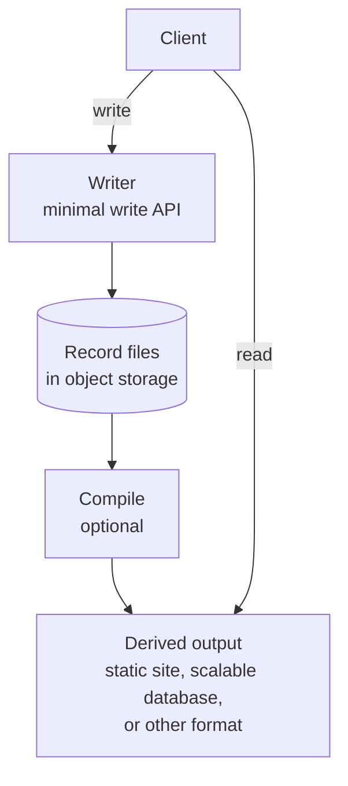

# YafiDB

**A database you can read, diff, and rebuild.**

YafiDB keeps records in plain files—the source of truth—and turns them into whatever a project needs: a static site, a queryable database, or another format. Files stay portable and easy to inspect; derived outputs can be deleted and rebuilt at any time.

> **Status: design stage.** This repository contains the design and examples, not working software. Names and interfaces are illustrative.

**Explore:** [Design overview](docs/design.md) · [Examples](examples/) · [Configuration](docs/configuration.md)

### Why YafiDB?

- **Keep data understandable:** records are ordinary files you can read, diff, back up, or work with using an AI assistant.
- **Catch bad edits:** every write is checked against the schema you define.
- **Writes included:** many tools can read flat files with a schema, and some can export new files. YafiDB also includes the write API: a small serverless worker that takes change requests, validates them, and adds records to the files.
- **Add complexity only when needed:** start with files, then optionally build a site or database for faster reads and richer queries.

## An example record

All of a record is your data, except the `yafi` field, which Yafi reserves for itself. Records are grouped into files by person or object and by period, such as one file per year: `contribution/alice/2026.yaml`. Each data type's schema sets the format, so files do not declare one. Each record is a YAML document added to the end of the file. A record is identified by its file path and `yafi.seq`. Records are never edited in place.

```yaml
# contribution/alice/2026.yaml
---
type: cash
amount: 5000
note: |
  Approved at the "Q1 review" (issue#3), see {appendix}.
  Quotes and backslashes \n stay as typed, and dashes --- do not end the block.
  Ratio 3:1, and accents and emoji work too, café 🎉
yafi:
  schema: contribution@1       # set by Yafi, not by the file
  seq: 1
  written_at: "2026-01-05T15:02:11Z"
  signatures:
    - protected: eyJhbGciOiJFZDI1NTE5Iiwia2lkIjoid29ya2VyLTIwMjYtYSJ9
      signature: 9fQk2x...       # placeholder for the base64url signature
```

- `yafi` is reserved for Yafi. Yafi sets everything in it and rejects any user field with that name. The writer also rejects duplicate keys, since some parsers silently keep only the last of two identical keys.
- `yafi.schema` names the schema for this data type. The writer sets it, so a file cannot choose its own.
- Your fields sit at the top level, as the schema defines them.
- `yafi.seq` and `yafi.written_at` are covered by the signature, so changing either breaks it. A signature cannot show that a record was removed or reordered. That needs chaining, described below. The timestamp is the worker's claim, not independent proof of when the record was made.
- `yafi.signatures` follows the JOSE JSON serialization (RFC 7515). Each entry's `protected` value is a base64url-encoded header that names the algorithm (`alg`) and the key (`kid`). A user who also signs their entry adds a second item to the list. The signatures are left out of the signed content, since they cannot sign themselves.

**Free text goes in as typed.** The `note` field takes any text with no escaping. The same `note` in JSON needs every quote and line break escaped:

```json
{"note": "Approved at the \"Q1 review\" (issue#3), see {appendix}.\nQuotes and backslashes \\n stay as typed, and dashes --- do not end the block.\nRatio 3:1, and accents and emoji work too, café 🎉\n"}
```

In the file, the writer stores this as an indented literal block under `note: |`. A YAML library does the wrapping, so the text cannot change the structure of the file. That makes it safe to store text from a Notion-style editor, a web form, or an AI agent. The one exception is control characters such as NUL, which YAML cannot store. Escaping for display, such as sanitizing HTML, is still the job of whatever renders the text.

## How it works



- **Client:** any app, website, or AI agent that reads or changes data.
- **Writer:** a minimal write API, built as a serverless function. It runs only when a write request arrives, validates the record against its schema, signs it, and adds it to a file. It serves no reads, so visitors never reach it.
- **Record files:** the data itself, stored in any object storage, such as Amazon S3 or Cloudflare R2. Files are split per person or object and per period, so each write rewrites only a small file.
- **Compile:** an optional step that builds derived outputs from the files. The files stay the source of truth. A derived output exists to meet a need the files do not meet well on their own: a static site for fast, cheap publishing, a scalable database for heavy queries, or a format another tool can read. Each output can be deleted and rebuilt from the files.

Writes and reads take separate paths. A write goes through a writer. A read skips the writers and goes to a derived output. If compiling is off, reads go to the files directly. Reads from a derived output can trail writes by a few seconds. Some sites need no writer at all; see the static website use case.

## How writes stay valid

A folder of files becomes a database when every write is checked against the same rules, by a writer or by the build.

- **You choose each schema, and Yafi enforces it.** Each data type has one schema, which you write. Yafi does not decide what the schema says. It makes sure every write follows the schema, and a file or client cannot use a different one. The writer sets `yafi.schema` on every record, so the name and version in a file always match the schema Yafi applied. Each schema version also pins the record format, so the signature covers the format too. In Git-only sites, the repository holds the schemas and the build enforces them.
- **Schemas are strict.** Every record must pass its schema before it is written. An invalid record is rejected, and nothing is written.
- **Schemas define the rules.** A schema describes one kind of record. JSON Schema is the first schema language, and it defines the fields and their types. [CEL](https://cel.dev), a small and safe expression language, adds computed values and checks across fields. For example, a contribution schema can compute a `slices` value from the record's `type`, `amount`, `hours`, and `hourly_rate` fields. Other schema languages may be added later, and each must be just as strict. See [example schemas](examples/schemas/).
- **Records are signed.** After validation, the writer signs the record, including everything in `yafi` except the signatures themselves. The signature is a standard JOSE signature (RFC 7515). Its header names the algorithm (`alg`) and the key (`kid`). The signed bytes are the record's canonical JSON (RFC 8785), with only `yafi.signatures` left out. A verifier finds the public key by `kid` in a JSON Web Key Set (RFC 7517), then confirms that the worker validated and wrote the record and that no one has changed it since. The worker uses `Ed25519`, the registered JOSE name (RFC 9864). A plain hash such as SHA-256 is not enough, because anyone who edits a file can recompute it. A shared-secret HMAC is not enough either, because any verifier holding the secret could create records. The signing key is kept separate from storage credentials, so someone who gets storage access cannot forge signed records. Records changed only through Git have no writer, so they are not signed.
- **Ledgers can also be chained.** For data where order and completeness matter, each record can link to the one before it. An edit, deletion, or reordering then breaks the chain. This is set per data type.

See [how schemas are enforced in docs/design.md](docs/design.md#schemas) for the full pipeline.

## Goals

1. **Fully static, with no servers and a small risk surface.** Nothing runs unless a request arrives, so there is no server to maintain, secure, or patch. Reads are plain static files, with no code to attack. Writes, if you want them, go through one minimal API that serves no reads and accepts only records that pass the schema. Then the system is static again.
2. **Easy for AI agents to start.** A project is files plus schemas. An AI can write and read both, and there is no infrastructure to set up.
3. **Low cost.** Small projects aim to cost nothing to run or to leave idle.
4. **Scale when needed.** Deriving a database for heavy queries is optional, and you choose the engine.
5. **Composable.** Most parts, from storage to schema language, can be chosen to fit the infrastructure of each application.

## Good fit and limits

- **Good fit:** records that change rarely and have a clear owner, such as ledgers, profiles, cap tables, recipe collections, guestbooks, and comments.
- **Not a fit:** high-volume streams such as access logs and telemetry. Use a streaming pipeline for those.
- **Git-only publishing:** every change is a commit, so use it only for sites that change rarely.
- **Tradeoffs:** compiled reads can lag writes by a few seconds, and storage request costs rise as write frequency grows. See [docs/tradeoffs.md](docs/tradeoffs.md).

## Use case: a static website with optional workers

Most of the site is static files: pages, styles, and data that any web host can serve. Hosting is cheap or free, and moving to another host means copying a folder. Workers are optional, and they only handle changes.

Changes can come in two ways:

- **Git only.** Records are YAML files in a Git repository. The author creates and edits them with a local YafiDB tool, which checks each record against its schema. The same build runs as a test in the repository, so a bad record fails it. GitHub, GitLab, or a similar host builds and publishes the site on each push. No write API runs, so this mode adds no write surface beyond the Git host itself. This suits sites that change rarely, because each change is a commit. Git history shows who changed what, but authorship is verified only when commits are signed.
- **Optional workers.** A minimal write API, run as a few small workers, accepts changes such as form submissions. Each one validates the record, signs it, and writes it to storage. The site is then rebuilt and redeployed. The workers handle only writes, and visitors never reach them.

Either way, the site is built from the records. The build can run in CI, or YafiDB can commit the generated site to a publish repository. See [docs/static-site.md](docs/static-site.md).

## Configurable parts

YafiDB is made of parts you can swap to fit your infrastructure. Each part has a default. Choices go in one config file, `yafidb.yaml`.

| Part | Default | Other choices |
| --- | --- | --- |
| **Record format** | YAML, set by each data type's schema | Other formats, if someone builds them |
| **Storage** | Any object storage, such as Amazon S3 or Cloudflare R2 | Git, for the Git-only sites in the use case |
| **Schema language** | JSON Schema, with CEL for computed values | Other schema languages, held to the same strict rules |
| **Signing** | Ed25519 (`alg` value `Ed25519`) | Other JOSE algorithms, each named by its `alg` value. A shared-secret option such as HS256 cannot prove who wrote a record |
| **Chaining** | Off | On, linking each record to the previous one, per data type |
| **Derived output** | None | A static site, SQLite (a single-file SQL database), a scalable database, or another format |
| **Where the writer runs** | Serverless function | Another serverless host, or none for Git-only sites |

The writer is designed for TypeScript or JavaScript on Node or Bun, with no separate server. Schemas are language-neutral, so they apply the same way whatever runs them.

Templates such as `s3+yaml+none` set the storage, format, and derived-output parts for you. A weekend project might use serverless functions, object storage, and no derived output. A ledger that moves money might add chaining and a dedicated database. The files stay the same in both. See [docs/configuration.md](docs/configuration.md).

## Learn more

New to YafiDB? Start with [docs/design.md](docs/design.md), then browse [examples/](examples/).

| File | What it answers |
| --- | --- |
| [docs/design.md](docs/design.md) | How the whole system works, with worked examples |
| [docs/configuration.md](docs/configuration.md) | How to set up each part, with templates and plug-in interfaces |
| [docs/static-site.md](docs/static-site.md) | How to publish a static website, with or without workers |
| [docs/decisions.md](docs/decisions.md) | What was decided, what was rejected, and why |
| [docs/tradeoffs.md](docs/tradeoffs.md) | The real costs and risks |
| [docs/prior-art.md](docs/prior-art.md) | Related projects and what each one teaches |
| [docs/comparison.md](docs/comparison.md) | How YafiDB compares with more than 50 other tools, and when to pick one of them instead |
| [examples/](examples/) | Sample config, record, and schema files |

*YafiDB stands for "Yet Another File Database".*
