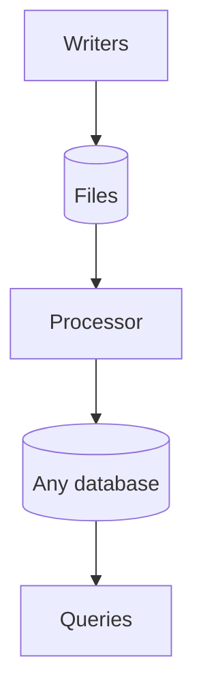

# omni-db

A design for a database whose source of truth is a set of human-readable files. Writing the files takes almost no CPU or server work. Every query, and all of the scale, comes from processing those files into any database engine you choose.

**Status:** design only. There is no code in this repository yet. Any future code will be written in TypeScript and run on Bun. The repository name is a working name.

## The idea in one paragraph

Human-readable files are the source of truth. A writer does as little as possible: it checks a request, appends records to a file, and flushes the file to any S3-compatible object store (a storage service that holds files and speaks Amazon's S3 protocol). A processor then turns those files into whatever database engine the use case needs, such as SQLite, DuckDB, Parquet, or a server database. Those databases are derived, so any of them can be deleted and rebuilt from the files. Because the files stay simple and the database engine is your choice, the same design works for a weekend project, personal accounting, a bank, or a very large system.

The diagram reads top to bottom. Writers are thin and only append and flush. Files in any S3-compatible store are the source of truth. The processor builds a derived, rebuildable database of any engine from them. Queries, APIs, spreadsheets, and reports read from that database.

The writers keep no database and run no queries, so they need almost no CPU and no always-on server. The processor and the derived databases carry the query and scale load, and they can be as small or as large as the use case needs.

## Range

The same core idea fits very different uses. Only the processing layer and the optional patterns change.

| Scale | Example |
| --- | --- |
| Weekend project | A guestbook, a recipe collection, a hobby tracker |
| Personal accounting | A household ledger with receipts |
| Small business | The LLC ownership and equity records that are this design's first use |
| Banking | Accounts and money movement |
| Very large scale | A video site's channels, comments, and likes |

## Optional patterns

Some use cases, such as money movement, need stronger guarantees. The design offers optional patterns for them. They are not part of what defines the system, and a weekend project uses none of them.

- **Integrity:** hash chaining and signatures that make history tamper-evident.
- **One owner per account:** a single writer per account, so two requests for the same account never run at once.
- **Sagas:** a way to make an action that touches several accounts finish completely or be reversed.
- **Tiered derived databases:** several layers of freshness for very large read loads.

## File format

All records and files are YAML today. YAML was chosen because it is human-readable, allows comments, lets several records sit in one file as documents separated by `---` so adding a record means appending, holds Markdown in `|` blocks without escaping embedded JSON, YAML, code, CSV, or HTML, and has parsers in almost every language.

YAML is the current format, not a permanent commitment. Each file declares its format and version in a header, such as `format: yaml/1`, and all reading and writing goes through a pluggable codec. A future version can adopt another format, such as a YAML 2 or one not yet invented, by adding a codec and a migration. See [File format and codecs](docs/design.md#file-format-and-codecs).

## Goals

- **Readable files as the truth.** A person can open a file and read the history.
- **Minimal CPU and server overhead.** Writers wake per request, append, flush, and sleep.
- **Any database for queries.** Scale comes from processing the files into the engine the use case needs.
- **Universal.** One storage model fits ledgers, profiles, posts, ownership records, and follows, from tiny to huge.
- **Near-zero incremental cost.** A small deployment costs $0 when nobody is using it.
- **Free and open-source software only.** Every part can be inspected, forked, and self-hosted.
- **No vendor lock-in.** The data is in an S3-compatible store, and the schemas and formulas are open standards.
- **Usable from familiar tools.** SQL, Google Sheets, Excel, and Google Drive work through exports and derived databases.
- **Auditability when needed.** The optional integrity pattern adds hash-chained, optionally signed history.

## Non-goals

- **Firehose data.** Access logs, telemetry, and other high-volume streams belong in a purpose-built pipeline.
- **High write rates on one record.** The design suits records that each change rarely.
- **Instant global reads.** Reads trail writes by seconds. Anything that needs an instant check asks the writer.
- **Git as the source of truth.** Git is used for code and model history only.
- **A new formula language.** Derived values use the existing CEL standard.

## First use case

The first user is Jonathan's LLC: a cap table (shares, changed monthly) and a Slicing Pie record (investments and labor, roughly daily). It migrates off Coda. See [docs/design.md](docs/design.md#first-use-case-the-llc-cap-table).

## Contents

| File | What it answers |
| --- | --- |
| [docs/design.md](docs/design.md) | How the whole system works, with examples |
| [docs/decisions.md](docs/decisions.md) | What was decided, what was rejected, and why |
| [docs/tradeoffs.md](docs/tradeoffs.md) | The real costs and risks |
| [docs/prior-art.md](docs/prior-art.md) | Related projects, with links, and how this design differs |
| [examples/](examples/) | Sample record files and model files |
