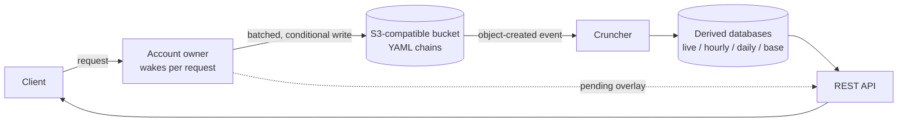

# omni-db

A design for a universal database that stores its data as readable, append-only YAML files in any S3-compatible bucket, costs nothing when idle, and uses only open-source parts.

**Status:** design only. There is no code in this repository yet. Any future code will be written in TypeScript and run on Bun.

## The idea in one paragraph

Every account or entity (a member, a user, a ledger) owns one append-only chain of YAML records stored in an object bucket. A small writer wakes up on each request, is the only writer for that one account, checks the request, and adds records to the chain. A separate job, the cruncher, reads newly written records and builds fast query databases from them. An API reads from those databases. The YAML files stay the source of truth, so every derived database can be thrown away and rebuilt.

Clients send requests to the account's owner. The owner appends records to the bucket. The bucket announces each new file. The cruncher turns new files into derived databases. The API answers reads from those databases, and mixes in the owner's not-yet-flushed changes so people see their own writes at once.

## Goals

- **Universal.** One storage model that fits ledgers, profiles, posts, ownership records, and follows.
- **Near-zero incremental cost.** A small deployment costs $0 when nobody is using it.
- **No always-on server.** Writers wake for each request and sleep afterward.
- **Free and open-source software only.** Every part can be inspected, forked, and self-hosted.
- **No vendor lock-in.** The data is YAML in an S3-compatible bucket. The schemas and formulas are open standards.
- **Human-readable storage.** A person can open a file and read the history.
- **Auditability.** Each account has its own authoritative, optionally signed, hash-chained record of everything that touched it.
- **Usable from familiar tools.** SQL, Google Sheets, Excel, and Google Drive work through exports and derived databases, not through the raw YAML.

## Non-goals

- **Firehose data.** Access logs, telemetry, and other high-volume streams belong in a purpose-built pipeline.
- **High write rates on one record.** The design suits records that each change rarely.
- **Instant global reads.** Reads trail writes by seconds. Anything that needs an instant check asks the account's owner.
- **Git as the source of truth.** Git is used for code and model history only.
- **A new formula language.** Derived values use the existing CEL standard.

## First use case

The first user is Jonathan's LLC: a cap table (shares, changed monthly) and a Slicing Pie record (investments and labor, roughly daily). It migrates off Coda. See [docs/design.md](docs/design.md#first-use-case-the-llc-cap-table).

## Contents

| File | What it answers |
| --- | --- |
| [docs/design.md](docs/design.md) | How the whole system works, with examples |
| [docs/decisions.md](docs/decisions.md) | What was decided, what was rejected, and why |
| [docs/tradeoffs.md](docs/tradeoffs.md) | The real costs and risks |
| [docs/prior-art.md](docs/prior-art.md) | Related projects, with links, and how this design differs |
| [examples/](examples/) | Sample YAML chains and a sample model file |
