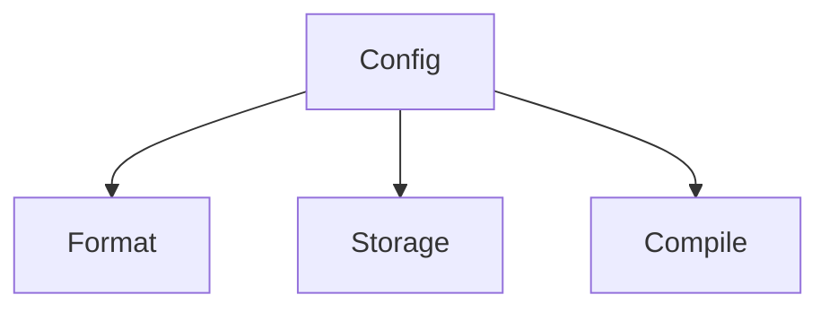

# YafiDB

YafiDB stands for "Yet Another File DB", a nod to YAML files. It is files as a database: a file access layer with three independent, pluggable parts that you choose in one configuration file. The three parts are the file format, the storage backend, and database compilation (which is optional).

**Status:** design only. There is no code in this repository yet. Any future code will be written in TypeScript and run on Bun.

## The idea in one paragraph

Human-readable files are the source of truth. YafiDB is only the layer that reads and writes them. How the files are encoded, where they are stored, and whether they are compiled into a database are three separate choices. The happy paths are simple, cheap, and open: YAML for the format, S3-compatible storage or git for storage, and either no compilation or SQLite. Other plug-ins exist as optional examples and are never required. Because the files stay simple and the database engine is your choice, the same design works for a weekend project, personal accounting, a bank, or a very large system.



The config picks one plug-in for each part. Each part works with any choice for the other two.

## Core goals

1. **Very easy for AI agents to spin up new projects.** A project is files plus model definitions, and an AI can generate and read both. There is no infrastructure to provision.
2. **$0 cost for most any project.** A small project costs nothing to run, and nothing when idle.
3. **Infinite scaling through optional database writing.** Writing or compiling derived databases is opt-in. A project turns it on when it needs it, and chooses the engine.
4. **Pluggable storage by stage.** The same files can live in a git repository, move to S3-compatible object storage, or be compiled into any database. The files do not change between stages.

## The three parts

| Part | What it decides | Happy paths | Other plug-ins (optional examples) |
| --- | --- | --- | --- |
| **Format** | How records are encoded in a file | YAML | A future YAML 2, or a format not yet invented |
| **Storage** | Where the files live | S3-compatible storage (for example Cloudflare R2's free tier), or git | A local folder, or [Cloudflare Artifacts](https://developers.cloudflare.com/artifacts/platform/pricing/) |
| **Compile** | Whether and how files become a database | None, or SQLite | DuckDB, Parquet, Postgres, or any other engine |

Cloudflare Artifacts is git-compatible versioned storage built on Durable Objects. It requires the Workers Paid plan, which has a $5 per month minimum, so it is not a $0 path.

Git is a supported storage backend. YafiDB is only the file access layer, so choosing git means accepting that git is slow for writes, has limited write concurrency, and grows with history. That is the user's choice. Projects that outgrow it move the same files to S3-compatible storage.

## Templates

A **template** is a named starting point that prefills the config. You can start from a template, change any part, or bring your own plug-in. Template names here are illustrative.

| Template | Format | Storage | Compile |
| --- | --- | --- | --- |
| `git+yaml+none` | YAML | git | None |
| `git+yaml+sqlite` | YAML | git | SQLite |
| `s3+yaml+none` | YAML | S3-compatible | None |
| `s3+yaml+sqlite` | YAML | S3-compatible | SQLite |

This is the config for the `git+yaml+none` template. All key names are illustrative.

```yaml
# yafidb.yaml
template: git+yaml+none
format:
  type: yaml
  version: 1
storage:
  type: git
  path: records/
compile:
  type: none
```

More examples are in [examples/config/](examples/config/), including one project that chose its own mix instead of a template.

## Bring your own plug-in

Anyone can replace any one of the three parts with their own plug-in: a custom format codec, a custom storage backend, or a custom compiler. At the interface level, each must provide the following. The design does not yet define code.

- **A format codec** provides a name and version (such as `yaml/1`), reads a file's bytes into records, writes records into bytes, and can add records to the end of a file.
- **A storage backend** lists files, reads a file with a version tag, and writes a file only if its version tag is unchanged. It can optionally announce changes.
- **A compiler** names its database engine and output, can build the whole database from scratch from the files, can optionally update from only the changed files, and never changes the files.

See [Plug-ins](docs/design.md#plug-ins) for the full description.

## Range

The same core idea fits very different uses. Only the configuration and the optional layers change.

| Scale | Example |
| --- | --- |
| Weekend project | A guestbook, a recipe collection, a hobby tracker |
| Personal accounting | A household ledger with receipts |
| Small business | The LLC ownership and equity records that are this design's first use |
| Banking | Accounts and money movement |
| Very large scale | A video site's channels, comments, and likes |

## Optional layers and features

YafiDB itself is only the file access layer. These are optional layers and features that a project turns on in its configuration, per project or per data type. A weekend project uses none of them.

- **Integrity:** hash chaining and signatures that make history tamper-evident.
- **One owner per account:** a single writer per account, so two requests for the same account never run at once.
- **Sagas:** a way to make an action that touches several accounts finish completely or be reversed.
- **Tiered derived databases:** several layers of freshness for very large read loads.
- **Models:** JSON Schema for fields and CEL for derived values.
- **API:** a REST API generated from the models.

## File format

All records and files are YAML today. YAML was chosen because it is human-readable, allows comments, lets several records sit in one file as documents separated by `---` so adding a record means appending, holds Markdown in `|` blocks without escaping embedded JSON, YAML, code, CSV, or HTML, and has parsers in almost every language.

YAML is the current format, not a permanent commitment. Each file declares its format and version in a header, such as `format: yaml/1`, and all reading and writing goes through a pluggable codec. A future version can adopt another format, such as a YAML 2 or one not yet invented, by adding a codec and a migration. See [File format and codecs](docs/design.md#file-format-and-codecs).

## More goals

- **Readable files as the truth.** A person can open a file and read the history.
- **Minimal CPU and server overhead.** Writers wake per request, append, flush, and sleep.
- **Any database for queries.** Scale comes from compiling the files into the engine the use case needs.
- **Universal.** One storage model fits ledgers, profiles, posts, ownership records, and follows, from tiny to huge.
- **Free and open-source software only.** Every part can be inspected, forked, and self-hosted.
- **No vendor lock-in.** The data is in readable files, and the schemas and formulas are open standards.
- **Usable from familiar tools.** SQL, Google Sheets, Excel, and Google Drive work through exports and derived databases.
- **Auditability when needed.** The optional integrity layer adds hash-chained, optionally signed history.

## Non-goals

- **Firehose data.** Access logs, telemetry, and other high-volume streams belong in a purpose-built pipeline.
- **High write rates on one record.** The design suits records that each change rarely.
- **Instant global reads.** Reads trail writes by seconds. Anything that needs an instant check asks the writer.
- **High write concurrency on git.** Git suits small projects. Projects with many concurrent writers use object storage.
- **A new formula language.** Derived values use the existing CEL standard.

## First use case

The first user is Jonathan's LLC: a cap table (shares, changed monthly) and a Slicing Pie record (investments and labor, roughly daily). It migrates off Coda. See [docs/design.md](docs/design.md#first-use-case-the-llc-cap-table).

## Contents

| File | What it answers |
| --- | --- |
| [docs/design.md](docs/design.md) | How the whole system works, with examples |
| [docs/decisions.md](docs/decisions.md) | What was decided, what was rejected, and why |
| [docs/tradeoffs.md](docs/tradeoffs.md) | The real costs and risks |
| [docs/prior-art.md](docs/prior-art.md) | Related projects, with links, and how this design differs |
| [examples/](examples/) | Sample config files, record files, and model files |
