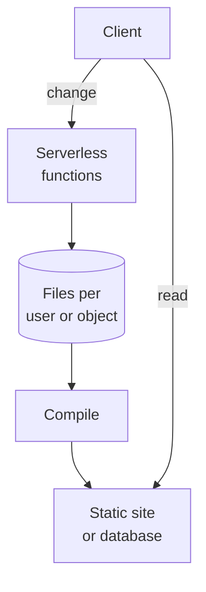

# YafiDB

YafiDB is a database tool that lets you store records as files. The files are the single source of truth: everything else can be thrown away and rebuilt from them.

Files on their own are only a collection of files. YafiDB reads and writes the files and makes sure they are structured properly. That is what turns them into a database.

## How it works

There are two separate paths. To change something, a client sends a request to a serverless function; one or many can run side by side, waking only when a request arrives. The function checks the request and adds records to files in S3-compatible storage, kept separate for each user or object. A compile step then rebuilds the static site or database from the files. To read, a client skips the functions and the files and goes straight to the compiled static site or database.

## The defaults

- **Format:** YAML files. YAML is easy for people and AI to read and write, and it allows comments and Markdown notes. Right now the focus is YAML, and we are open to adopting other formats in the future.
- **Storage:** any S3-compatible storage.
- **Compilation:** none, or a SQLite database.

YafiDB is composable. The format, the storage, and the compilation are each configurable, and more options may be added in the future. See [docs/configuration.md](docs/configuration.md).

## Goals

1. **Very easy for AI agents to start a new project.** A project is files plus model definitions that an AI can write and read, with no infrastructure to set up.
2. **$0 cost for most any project.** A small project costs nothing to run, and nothing when idle.
3. **Scale when you need it.** Compiling the files into a database is optional, and you choose the engine.
4. **Composable.** The format, storage, and compilation are each configurable.

## A fully static website

One key use is a website with no server at all. The files are compiled into a static site, and the generated site is committed to a repository that GitHub Pages, Cloudflare Pages, or any static host can publish. Only changes go through a small worker. See [docs/static-site.md](docs/static-site.md).

## Learn more

| File | What it answers |
| --- | --- |
| [docs/design.md](docs/design.md) | How the whole system works, with examples |
| [docs/configuration.md](docs/configuration.md) | Settings, templates, and plug-in interfaces |
| [docs/static-site.md](docs/static-site.md) | How to publish a fully static website |
| [docs/decisions.md](docs/decisions.md) | What was decided, what was rejected, and why |
| [docs/tradeoffs.md](docs/tradeoffs.md) | The real costs and risks |
| [docs/prior-art.md](docs/prior-art.md) | Related projects, with links |
| [examples/](examples/) | Sample config, record, and model files |

*YafiDB stands for "Yet Another File DB".*
