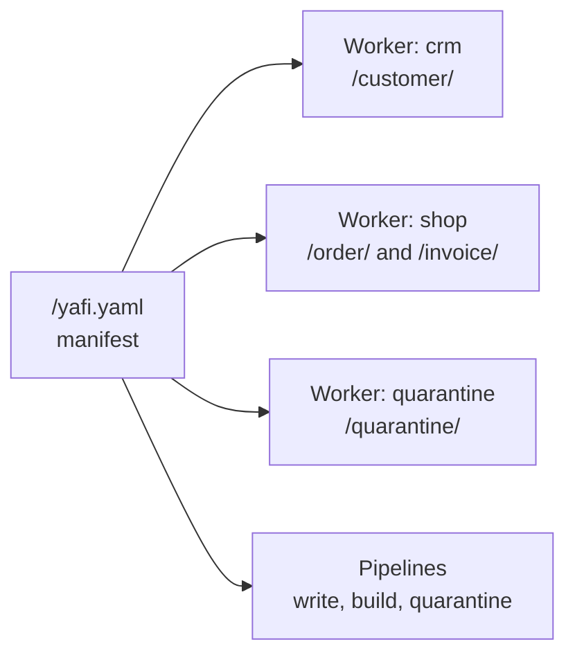
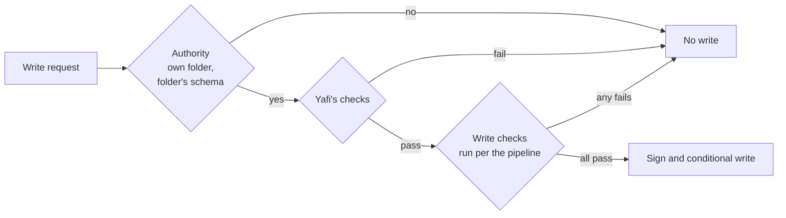
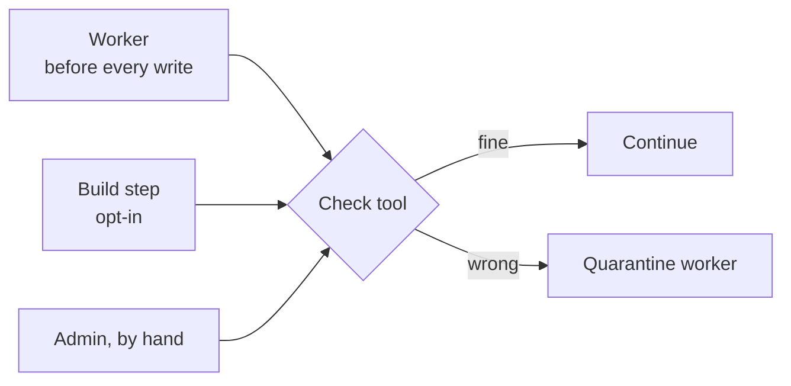
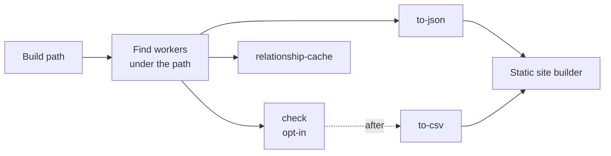
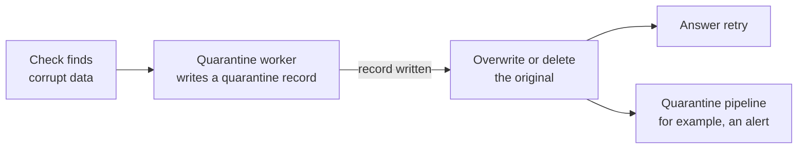

# Architecture

How a YafiDB deployment is organized: who may write where, what runs on a write, and what runs on a build. Start with the [README](../README.md). Record contents are in [record-format.md](record-format.md).

## Terms

| Term | Meaning |
| --- | --- |
| **Root** | Everything under one manifest: every folder, file, and worker of a deployment. |
| **Manifest** | `/yafi.yaml` at the top of the root. The single source of truth for who may write where, which schema applies, and which pipeline steps run. |
| **Worker** | The only writer for its folders. It may read anything in the root, so it can validate references and permissions, but it writes only inside its own folders. |
| **Folder rule** | A line in the manifest that maps a folder to a schema. The nearest rule above a file applies, so subfolders inherit it. |
| **Schema** | The definition of a record type. One schema may cover several folders. A folder has exactly one schema. |
| **Write check** | A pipeline step that must pass before a write is signed. |
| **Check tool** | A standalone tool that verifies a file as its folder requires and quarantines what is wrong. A worker always runs it before writing. A build may run it as an opt-in step. Nothing else validates. |
| **Build step** | A pipeline step that makes output from files. A build reads and validates nothing. Builds are optional. |
| **Pipeline** | The steps for writes, builds, or quarantine, each with the steps it runs after. Steps with no dependency between them run in parallel. |
| **Quarantine** | The default schema and worker that receive corrupt data. Only the check tool sends data there. |



## The manifest

```yaml
# /yafi.yaml
workers:
  crm:
    folders:
      /customer/: customer@1
  shop:
    folders:
      /order/: order@1
      /invoice/: invoice@1
  quarantine:
    folders:
      /quarantine/: quarantine@1
pipelines:
  write:
    - name: permissions
      url: https://auth.example.com/check
    - name: audit
      command: [./audit-check]
      after: [permissions]
  build:
    - name: relationship-cache
      builtin: relationship-cache
      out: /var/cache/yafi/cache.sqlite
    - name: to-json
      command: [./to-json]
      out: /var/build/json
    - name: to-csv
      command: [./to-csv]
      out: /var/build/csv
    - name: site
      command: [./static-site]
      in: [/var/build/json, /var/build/csv]
      out: /var/www
      after: [to-json, to-csv]
```

The manifest is rejected, and no worker starts, if any of these hold:

- Two workers list the same folder.
- A folder of one worker sits inside a folder of another worker.
- A folder has no schema, or names a schema that does not exist.
- A pipeline step is duplicated, depends on an unknown step, or is part of a cycle.

Folders may nest inside the same worker. The nearest rule wins, which lets one worker give a subfolder its own schema.

The manifest may be signed with the admin key so that workers refuse a tampered copy. Signing is optional and changes nothing else.

## Writes

A write is a request to one worker. The worker accepts it only if the path is inside its own folders.



- **The check tool** runs on the file first. See [The check tool](#the-check-tool).
- **Yafi's checks** run next. They are listed in [record-format.md](record-format.md#enforced-checks).
- **Write checks** are the admin's own steps, in any language. A step is a command or an HTTP endpoint. It receives the proposed entry and the existing file, never the database, and it answers pass or fail. Steps with no `after` run together, and a step runs only once everything it follows has passed. Any failure rejects the write.
- Only Yafi signs and appends. The write is conditional on the version read, so of two simultaneous valid appends one succeeds and the other gets a conflict with nothing written. A success always means the entry is in the file. See [Concurrent writes](record-format.md#concurrent-writes).

Any path outside every worker folder, including the manifest itself, is refused. Changing the manifest is an admin action.

## The check tool

The check tool is separate from the worker and from builds, and can run alone (`bun run check [path]`). For each file it confirms that:

- the header's version is one the tool supports,
- every signature and chain link verifies, and
- the header's schema is the schema of the file's folder.

Files outside every worker folder are not checked. Whatever fails is quarantined by the tool (see [Quarantine](#quarantine)), and anything that runs the tool automatically gets the same result.

- **A worker** always runs it on a file before writing to it. If the file is wrong, it is quarantined, the write is refused, and a retry works.
- **Reads** do not run it. Records are often converted to other formats and published, so a reader may be nothing more than a browser.
- **A build** does not run it by default. An admin can add it as a step, and the later steps `after` it then see only checked files.



## Builds

A build is optional. A project can read its files directly, or run any mix of steps. A build only reads files and runs steps. It does no validation and no quarantine.



1. Given a path, the build finds the folders under it from the manifest.
2. It runs the build pipeline. Each step gets paths to read and a path to write, not the database. Outputs can live anywhere. Build steps never write into worker folders.

To build from checked data only, add the check tool as a step and put `after: [check]` on the steps that need it:

```yaml
pipelines:
  build:
    - name: check
      command:
        - bun
        - src/check-cli.ts
        - /order/
    - name: static-site
      after:
        - check
      builtin: static-site
      out: dist/site
```

Yafi ships a few default steps, such as the relationship cache that renames use and a static site. They are listed in the manifest like any other step, so an admin can remove or replace them. They read files as they are, without checking them.

## Quarantine

Quarantine is a schema, `quarantine@1`, owned by its own worker. Only the check tool sends data there, and it is the only thing with quarantine tools.



- One rule for both cases: the problem data is logged to quarantine first, and only after that succeeds is the original changed. If the log fails, the original is left alone.
- A file that fails mid-way keeps its verified entries. Everything after the break is logged, then the original is overwritten with the verified part, with a conditional write.
- A file with no verified header, or that holds a different schema than its folder, is logged whole, then a delete is attempted. A header version the tool does not support counts here, like any other corruption. So does any file in a worker folder that did not come through its worker.
- The record's name comes from a hash of the logged text, so repeating a quarantine adds nothing. A delete is only an attempt: if the file is still there, the next check logs it again and tries again. No locks are used.
- An admin can keep this behavior, replace it, or add steps to the `quarantine` pipeline, such as alerts. Those steps run after the move and cannot undo it.

The record layout is in [record-format.md](record-format.md#broken-or-corrupted-files), and the races are in [record-format.md](record-format.md#concurrent-writes). Versions are in [record-format.md](record-format.md#format-versions).
