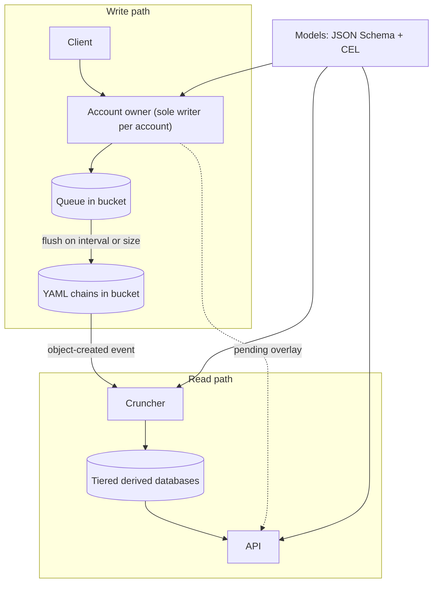

# Design

This document describes the whole system: what is stored, how writes and reads work, how models define data, and how the pieces stay correct when many things happen at once. It starts with the big picture and a worked example, then goes through each part in detail.

## Contents

1. [The big picture](#the-big-picture)
2. [A worked example](#a-worked-example-alice-pays-bob)
3. [Storage](#storage)
4. [Integrity](#integrity)
5. [Models](#models)
6. [Writes](#writes)
7. [Reads](#reads)
8. [API](#api)
9. [Failure taxonomy](#failure-taxonomy-races-partial-failures-and-torn-reads)
10. [Fit and scale](#fit-and-scale)
11. [First use case: the LLC cap table](#first-use-case-the-llc-cap-table)
12. [Open questions](#open-questions)

## The big picture

The system has five parts. Each part has one job.



1. **Chains** are append-only YAML files in an S3-compatible bucket. They are the source of truth.
2. **Owners** are small actors, one per account. Each owner is the only writer for its account, so two requests for the same account never run at the same time.
3. **Models** describe each kind of record with JSON Schema and compute derived values with CEL (Common Expression Language, a small safe formula language).
4. **The cruncher** reads new chain data and builds derived databases, which are effectively precomputed API responses.
5. **The API** answers reads from the derived databases and writes by passing requests to owners.

Nothing runs when nobody is using the system. Owners wake per request. The cruncher wakes per event. The bucket and the derived databases sit idle at storage cost only.

## A worked example: Alice pays Bob

All values here are illustrative. This example follows one transfer through the whole system.

Alice has a balance of 500 units. She asks to send 100 units to Bob.

1. **The request arrives** at the API with an idempotency key, `req_7f3a`. This is a unique ID for the action, so a retry can never apply it twice.
2. **Alice's owner wakes.** It is the only writer for Alice's chain. It checks her balance (500), sees the transfer is allowed, and queues the record `pending, -100, transfer t_881`.
3. **Bob's owner wakes.** It queues `+100, transfer t_881` in Bob's chain.
4. **Alice's owner confirms.** It queues `confirm t_881`. If Bob's owner had failed, Alice's owner would queue `reverse t_881` instead.
5. **Each owner flushes** its queue to its own chain file in the bucket with a conditional write.
6. **The bucket emits events.** The cruncher wakes, reads only the changed batches, and updates the derived databases.
7. **Reads** now show Alice at 400 and Bob at 600. Until the cruncher finishes, the API adds each owner's pending changes on top so Alice sees her own transfer immediately.

Both accounts end up with their own complete, signed record of the transfer. The shared ID `t_881` lets an auditor match the two sides.

The rest of this document explains each piece of that flow.

## Storage

Storage answers one question: where does the truth live, and what does it look like?

### Chains

Each account or entity has its own **chain**: an append-only sequence of YAML documents. A chain is stored as one or more files in an S3-compatible bucket. A file holds several YAML documents separated by `---`, which is standard multi-document YAML.

```yaml
---
id: rec_000001
seq: 1
schema: contribution@1
type: cash
amount: 5000
note: |
  Initial investment, wired 2026-01-05.
---
id: rec_000002
seq: 2
schema: contribution@1
type: time
hours: 12
note: |
  Built the first prototype.
```

See [examples/chains/](../examples/chains/) for full records with hashes and signatures.

### Freeform Markdown and embedded code

Any text field can use a YAML literal block scalar (`|`). Everything inside a `|` block is taken literally, so Markdown, JSON, YAML, and code need no escaping. This keeps notes and attachments readable.

````yaml
note: |
  ## Board decision

  We agreed to issue 1,000 new shares. The request payload was:

  ```json
  {"member": "alice", "shares": 1000, "memo": "line one\nline two"}
  ```

  And the config snippet:

  ```yaml
  vesting:
    cliff_months: 12
    total_months: 48
  ```

  ```ts
  const pct = (mine / total) * 100;
  ```
````

### Object store and the "S3 cannot append" problem

The bucket is any S3-compatible service. Cloudflare R2 is the first choice. At large scale the bucket can be your own S3-compatible storage placed near the cruncher.

S3-compatible stores cannot append to an object. To add a record, the writer rewrites the whole object. To make that safe, it uses a **conditional write**: it sends the object's version tag (ETag) in an `If-Match` header, and the store rejects the write if someone else changed the object first. The writer then re-reads and retries. This is why each account has a single owner: conditional writes are the safety net, and the owner makes conflicts rare.

### File layout

Two rules keep files at a useful size.

- **Split by time.** A chain is stored as one file per period, for example per year: `chains/member/alice/2026.yaml`. This bounds the cost of rewriting a file. The size limit is a tuning choice, not a standard. A year per file suits low-write chains like the LLC. Busier chains can split by month.
- **No tons of tiny files.** Storage requests cost money and small objects are slow to list. At large scale, batches from many accounts can share physical files, with an index recording which byte range belongs to which chain. A small deployment does not need this.

Each file name and path is stable and predictable, so any tool can find a chain without a database.

## Integrity

Integrity answers one question: how can anyone tell that history was not changed?

Integrity features are **optional per data type**. A ledger turns them on. A high-volume feed of low-value records can leave them off.

### Hash chaining

Each record carries its sequence number (`seq`) and the hash of the previous record (`prev`). Changing any old record changes its hash, which breaks every link after it. This detects edits, deletions, and reordering.

### Signatures

Records are signed with **Ed25519**, a widely used public-key signature scheme.

- **The worker signs the chain wrapper.** The wrapper is the part that holds `seq`, `prev`, and the record's hash. The signature proves the system wrote it.
- **The user may also sign their own entry.** This proves the user asked for the action, and it is optional.
- **The signing key is kept separate from storage credentials.** Someone who steals bucket access cannot forge signed history.

An **index** can be turned on to make verification faster: a small file listing each file's last `seq` and head hash, so a verifier does not have to read every file to check the latest state.

### Schema versions and migration

Every record carries a schema version, for example `schema: contribution@1`. Old records stay valid under their old schema.

To change a schema in a way that needs rewriting history, the system uses a **migration**: it starts a new chain whose first record is a signed **genesis record**. The genesis record names the old chain and holds the old chain's last hash. The migration script is deterministic and reproducible, so anyone can run it against the old chain and get the same new chain.

## Models

Models answer one question: what does a record look like, and what can be calculated from it?

Models are **language-neutral**. They use two open standards.

- **JSON Schema** describes fields: names, types, allowed values, and required fields.
- **CEL (Common Expression Language)** calculates derived values and, optionally, checks rules that involve more than one field. CEL is a small expression language from Google with mature implementations in Go, Java, C++, Rust, Python, and JavaScript.

An engineer can use JSON Schema validation, CEL checks, or both. The system supports both and does not force a choice.

### Where formulas live

Each formula sits on its own model, next to the fields it uses. Opening a model shows its fields and its math together, the way a spreadsheet column carries its formula. There is no shared file of unrelated formulas.

Derived values go in an `x-computed` keyword. Optional cross-field rules go in `x-validate`.

```yaml
# examples/models/contribution.model.yaml (abridged)
$id: contribution
type: object
properties:
  type: { enum: [cash, time, equipment] }
  amount: { type: number }
  hours: { type: number }
  hourly_rate: { type: number }
x-computed:
  slices: |
    type == 'time' ? hours * hourly_rate * 2.0
    : type == 'cash' ? amount * 4.0
    : amount
x-validate:
  - expr: "type != 'time' || (has(hours) && has(hourly_rate))"
    message: "Time contributions need hours and hourly_rate."
```

See the [full sample model](../examples/models/contribution.model.yaml).

### Related records stay pure CEL

CEL cannot define new functions. Instead, the engine passes related records in as variables. A member's formula can see `contributions` (this member's records) and `all_contributions` (everyone's).

```
size(contributions) == 0 ? 0.0
  : sum(contributions.map(c, c.slices)) / sum(all_contributions.map(c, c.slices)) * 100.0
```

CEL has no built-in `sum` over a list. The engine registers one small standard extension for it, the same way in every runtime. That keeps the formulas themselves in plain CEL.

### Why CEL is safe to run

CEL is built so an expression can only compute.

- It has no file, network, clock, or import access. An expression sees only the variables the engine hands it.
- It has no unbounded loops or recursion, so it always finishes.
- It is type-checked before it runs.
- It has no side effects.

It is an open specification with a shared conformance test suite, and it runs untrusted expressions in Kubernetes admission policies.

### Save-time checks

When a model is saved, the system does five things before accepting it:

1. Parse every CEL expression.
2. Type-check it against the declared fields.
3. Enforce a cost limit and a maximum expression length.
4. Run it against sample records.
5. Show a before-and-after preview of the affected totals.

A model change is itself a record, signed like any other. Git also records model files, so the history of the math is auditable in two places.

### Where formulas run

- **Official results run on the server**, using a mature, signed, pinned CEL implementation. Anything official, like a signed snapshot or a cap table export, comes from here.
- **Client-side JavaScript may evaluate the same CEL for display.** A client can fake what it shows to itself anyway, so display values need no extra trust. If two implementations ever disagree, that is a defect in an implementation, not a design problem.

## Writes

Writes answer one question: how do changes get in without races, double spends, or half-finished actions?

### One owner per account

Each account has one **owner**: a small actor that is the only writer for that account. It handles one request at a time. That removes races inside the account by design.

- On Cloudflare, an owner is a Durable Object, which wakes on request and sleeps when idle.
- When self-hosted, an owner is a cell in [celld](https://celld.dev/).

The owner is per account, not per kind of action. Alice's account and Bob's account have different owners, so a million users means a million mostly idle owners. No single transfer worker has to handle everyone's traffic.

### Cross-account actions are sagas

An action that touches several accounts is a **saga**: a series of steps, each handled by one account's owner, tied together by a shared transaction ID.

1. **Pending.** The first owner checks its rules and records a pending change.
2. **Apply.** Each other owner records its own side of the change.
3. **Confirm.** The first owner records that all sides succeeded.
4. **Reverse.** If any step fails, a reversing record undoes the earlier steps.

A progress log lets a crashed saga resume. Readers treat pending entries as not final. Every account keeps its own complete record, and the shared ID lets an auditor match the sides.

The same pattern covers three-way trades, bill splits, and account merges. At each step that needs to block conflicts, the owner for that account serializes the check.

### Idempotency keys

Every action carries a unique idempotency key. Owners and the cruncher skip any key they have already applied. A retried request therefore never counts twice.

### Batching and the queue

Writing a whole object per record would be slow and costly. Owners instead **batch**.

- Each owner keeps a **queue** of accepted records. The queue lives in the bucket (R2 or any S3-compatible store). A key-value store would be cheaper for some uses, but a bucket queue is portable and strongly consistent, so it was preferred.
- The owner **flushes** the queue into the chain file on an interval or when it reaches a size limit. The flush is a single conditional write.
- Records still in the queue are visible through the pending overlay (see Reads).

### Hot accounts

A very busy single account is a one-at-a-time bottleneck. The fix is to split it into sub-accounts, the way banks use omnibus accounts. This is rare, and the extra load stays with that one account.

## Reads

Reads answer one question: how do users query fast data that is built from slow, readable files?

### Flush events

Each flush produces an object-created notification (for example, [R2 event notifications](https://developers.cloudflare.com/r2/buckets/event-notifications/), or a webhook on another S3-compatible store). The notification wakes the cruncher.

### The cruncher

The cruncher ingests **only the changed batches**.

- It **dedupes by batch ID**, so a duplicated event does nothing.
- It **orders by per-chain sequence number**, so out-of-order events still apply correctly.
- It runs a **periodic sweep** that lists the bucket and catches any batch whose event was missed.

For each new record, the cruncher validates it against its model, evaluates the CEL computed fields, and writes the results into the derived databases.

### Tiered derived databases

The cruncher maintains tiers, from freshest to most settled.

| Tier | Holds | Why it exists |
| --- | --- | --- |
| Live | Changes from the last few seconds | Fast freshness |
| Hourly | Merged live changes | Keeps the live tier small |
| Daily | Merged hourly changes | Keeps hourly small |
| Base | Everything, compacted | Fast queries over all history |

The format is the engineer's choice: Parquet, DuckDB, SQLite, or any other engine. The tier names are a structure, not a requirement. The LLC runs a single tier rebuilt nightly.

These databases are effectively **precomputed API responses**. Most API reads become simple lookups.

### Complete snapshots only

Readers see only **published, complete** tiers. A tier is published after it is fully built, never while half-written. This prevents readers from seeing a half-applied update.

### Pending overlay

Because reads trail writes by seconds, the API overlays the owner's pending records on top of the derived data. That gives **read-your-writes**: a user always sees their own changes at once.

### Full replay

Because the chains are the truth, the cruncher can discard every derived database and rebuild from the chains. The same replay serves audits.

### Exports to everyday tools

The raw YAML is not meant to be queried from SQL or a spreadsheet directly. Derived databases and exports provide that access.

- **SQL:** the derived databases are SQL-queryable (DuckDB, SQLite).
- **Sheets, Excel, and Drive:** the cruncher can write CSV or spreadsheet exports to a folder those tools read.

## API

The API is built with [Hono](https://hono.dev), which runs on Cloudflare Workers, Bun, Deno, Node, and celld, so the same code moves between hosts.

- **REST comes first.** Routes are generated from the models. REST caches simply and is the easiest to get right.
- **GraphQL is an optional later layer** on the same derived databases. It would not change storage or models. It brings known costs: nested queries can cause one lookup per item, so it needs batching (DataLoader style), depth and cost limits, and saved queries to restore caching. GraphQL mutations would pass through the same owners and sagas.

## Failure taxonomy: races, partial failures, and torn reads

Three different problems can corrupt data. They have different fixes, so naming them separately matters.

| Problem | What happens | Fix in this design |
| --- | --- | --- |
| **Race** | Two actions run at once and both pass a check | A single owner per account serializes them |
| **Partial failure** | An action does some steps and then stops | Sagas with reversals, plus idempotent retries |
| **Torn read** | A reader sees an update half applied | Complete published snapshots and chained records |

### Examples

**Race: double spend.** Alice has 100 units. Two requests to send 100 units arrive at once. Without an owner, both read "100" and both pass. With one owner for Alice, the second request waits, sees 0, and fails.

**Race: duplicate username.** Two people claim `river` at the same moment. The username has a single owner, so one wins.

**Partial failure: two-party transfer.** Alice's debit is written and then Bob's credit fails. The saga writes `reverse t_881` on Alice's chain.

**Partial failure: three-party trade.** Alice gives shares to Bob, Bob gives cash to Carol, and Carol gives a license to Alice. Each leg is a step under one transaction ID. If the third leg fails, the saga reverses the first two in reverse order. The progress log lets a crashed coordinator resume instead of leaving one leg dangling.

**Partial failure: bill split among four.** One payer is charged and three others owe shares. Each of the four accounts records its own side under the same ID. If one fails, all sides reverse.

**Torn read: cap table total.** A transfer moves 10% of the shares from Alice to Bob. A reader sums holdings between the debit and the credit and sees 99.9% or 110%. Readers only see complete published snapshots, so the total is always 100%.

**Torn read: pending saga.** A reader sees `pending -100` on Alice but no matching credit on Bob. Readers treat pending entries as not final and exclude them from official totals.

## Fit and scale

### What fits

- Records that change rarely per entity and have a clear owner: ledgers, profiles, posts, ownership, follows, contracts, comments, and messages.
- **Likes** work as per-user facts, with aggregated counts that tolerate a few seconds of delay.

### What does not fit

- Firehose streams such as access logs and telemetry. Use a purpose-built pipeline.

### Scale notes

- **Writes scale per account.** There is no central write path, so adding accounts adds owners rather than load on one database.
- **Reads scale freely.** Derived databases are read-only and can be copied or cached.
- **Request cost is the pressure point.** Rewriting objects and listing the bucket cost money per request. Batching, time-split files, and shared physical files keep that bounded.
- **At large scale,** use storage you control near the cruncher, shared physical files for many accounts, and the full tier set.

### Thought experiment: a video site like YouTube

Consider the records of a video site, not the video bytes.

- **Channels, profiles, subscriptions, and video metadata** are owned, low-write records. They fit well.
- **Comments** are owned records with modest write rates. They fit.
- **Likes** fit as per-user facts, with counts aggregated by the cruncher.
- **View counts and watch-time telemetry** are firehose data. They do not fit and belong in a streaming pipeline.
- **The video files themselves** sit in object storage and are referenced by the records.

The design handles the owned records and leaves the firehose to the right tool.

## First use case: the LLC cap table

The first use is Jonathan's LLC, which is migrating off Coda. It needs two things:

- A **cap table** of shares, changed about monthly.
- A **Slicing Pie** record of investments and labor, written about daily. (Slicing Pie is a method for splitting equity in an early company in proportion to what each person contributes.)

The setup:

- **One owner** for the cap table.
- **Three models:** member, share transaction, and contribution, each with CEL formulas for derived values like slices and percentage of the pie.
- **Signed, hash-chained** YAML chains in R2.
- **A nightly cruncher** rebuilds all derived data. At this volume, tiers add nothing.
- **A static site on Cloudflare Pages behind Cloudflare Access.** Cloudflare Access does the sign-in, so no middleware is needed.
- **Cost:** $0 while idle.

This is the same design as the large version, with a single owner and a single tier.

## Open questions

- **Index format:** the exact layout of the optional chain index and of shared physical files at scale.
- **Key rotation and revocation:** how signing keys change over time and how old signatures stay verifiable.
- **Schema upgrade strategy:** versioned schemas with upgrade-on-read versus new chains by migration, per data type.
- **Choice of CEL implementations:** which mature server-side implementation to pin first, and which JavaScript port to use in the browser.
