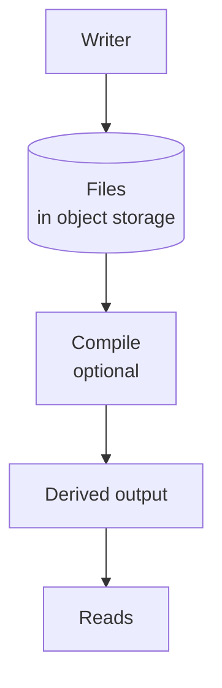

# Design

This document describes the whole system: what is stored, how writes and reads work, how schemas define data, and how integrity and write coordination add stronger guarantees. The core idea comes first, then worked examples, then each part in detail.

## Contents

1. [The core idea](#the-core-idea)
2. [Configuration](#configuration)
3. [Two worked examples](#two-worked-examples)
4. [Storage](#storage)
5. [Record format](#record-format)
6. [Writes](#writes)
7. [Reads](#reads)
8. [Schemas](#schemas)
9. [Integrity](#integrity)
10. [Write coordination (open decision)](#write-coordination-open-decision)
11. [API](#api)
12. [Failure taxonomy](#failure-taxonomy-races-partial-failures-and-torn-reads)
13. [Fit and scale](#fit-and-scale)
14. [First use case: the LLC cap table](#first-use-case-the-llc-cap-table)
15. [Open questions](#open-questions)

## The core idea

**YafiDB is a database tool that stores records as files. The files are the single source of truth.**

Files alone are only a collection of files. The writer checks every write against its schema and keeps the files structured properly. That is what turns them into a database. Several parts are configurable. By default, records are YAML files in any object storage, and no derived output is built. See [Configuration](#configuration).

### How data flows

The data flow has three layers, and each layer has one job.



1. **Files** hold the truth. A person can open any file in a text editor and read the history. Any object storage holds them.
2. **The writer** does as little as possible. It is a minimal write API, a serverless function that runs only when a write arrives. It validates the record against its schema, signs it, and adds it to a file. It keeps no database and runs no queries, so it needs almost no CPU and no always-on server.
3. **Compiling** is optional. Compile builds derived outputs, such as a static site, a scalable database, or SQLite, from the files. Derived outputs can be deleted and rebuilt from the files. Queries, reports, and scale come from this layer when a project turns it on.

The files stay simple at every size. Derived outputs can use any engine or format you choose.

### Goals

YafiDB has five goals, in this order.

1. **Fully static, with no servers and a small risk surface.** Nothing runs unless a request arrives, so there is no server to maintain, secure, or patch. Reads are plain static files, with no code to attack. Writes, if you want them, go through one minimal API that serves no reads and accepts only records that pass the schema. Then the system is static again.
2. **Easy for AI agents to start.** A project is files plus schemas. An AI can write and read both, and there is no infrastructure to set up.
3. **Low cost.** Small projects aim to cost nothing to run or to leave idle.
4. **Scale when needed.** Deriving a database for heavy queries is optional, and you choose the engine.
5. **Composable.** Most parts, from storage to schema language, can be chosen to fit the infrastructure of each application.

### Range

The same core idea covers a wide range. Only the configuration and the features turned on change.

| Scale | Example | What it uses |
| --- | --- | --- |
| Weekend project | A guestbook or a recipe collection | Readable files, the writer, and a small SQLite file built on demand |
| Personal accounting | A household ledger and receipts | The same, plus a nightly export to a spreadsheet |
| Small business | The LLC cap table and equity tracking in this repository | The same, plus chaining |
| Banking | Accounts and money movement | The same, plus chaining and a write-coordination design that is still open |
| Very large scale | A video site's channels, comments, and likes | The same, plus tiered derived outputs and shared physical files |

### Optional layers and features

Everything below is optional or still open. A project turns each one on in its configuration, per project or per data type. A weekend project can keep the defaults.

- **Integrity:** every record the writer writes is signed. Chaining is optional and set per data type. See [Integrity](#integrity).
- **Write coordination (open decision):** how concurrent changes stay correct. Sagas are the proposed direction, with one owner per account as one option under consideration. See [Write coordination](#write-coordination-open-decision).
- **Tiered derived outputs:** several layers of freshness for very large read loads. See [Reads](#reads).
- **Schemas:** JSON Schema for fields and CEL for computed values. See [Schemas](#schemas).
- **API:** the writer is the write API. Any read API is a project choice. See [API](#api).

### Why the records are YAML today

Every record file is YAML today. YAML was chosen for these reasons:

- **Human-readable.** People can read, review, and edit it without special tools.
- **Comments.** A person can leave notes in a file.
- **Appendable.** Several records can sit in one file as separate documents divided by `---`, so adding a record means adding to the end.
- **Markdown without escaping.** A `|` block holds Markdown, and embedded JSON, YAML, code, CSV, or HTML, exactly as typed.
- **Universal tooling.** Parsers exist in almost every language.

YAML is the current record format, not a permanent commitment. Each data type's schema sets its format, so a later version can adopt another. See [Record format](#record-format).

## Configuration

This section answers one question: how does a project choose how it works?

Each project has one configuration file, called `yafidb.yaml` in these examples. Each part below has a default, and each can be configured on its own.

- **Record format:** set per data type by its schema, with `x-format`. YAML today.
- **Storage:** any object storage, such as Amazon S3 or Cloudflare R2. Git for Git-only sites.
- **Schema language:** JSON Schema, with CEL for computed values. Other schema languages must be just as strict.
- **Signing:** Ed25519 by default. Other JOSE algorithms can be used.
- **Chaining:** off by default. Turned on per data type.
- **Derived output:** none by default. A static site, SQLite, a scalable database, or another format.
- **Where the writer runs:** a serverless function. Another serverless host, or none for Git-only sites.

Write coordination is not in this list. It is an open design decision. See [Write coordination](#write-coordination-open-decision).

Templates such as `s3+yaml+none` fill in the storage, format, and derived-output parts for you. Templates, an example config, and the interface descriptions are in [docs/configuration.md](configuration.md). A fully static website compiled from the files is described in [docs/static-site.md](static-site.md).

## Two worked examples

All values here are illustrative. The first example uses only the core idea with the `s3+yaml+sqlite` template. The second adds chaining and the proposed write coordination, which is still an open decision.

### A weekend project: a guestbook

A visitor signs a guestbook on a small site.

1. **The request arrives.** The writer receives `{name: "Sam", message: "Nice site!"}`.
2. **The writer adds a record.** It validates and signs one record, adds it to `guestbook/2026.yaml`, and writes the file to storage. It does nothing else.
3. **The storage announces the new file.** If compiling is on, a compile step reads the changed file and updates a SQLite database (a small single-file SQL database).
4. **The page loads.** It reads the latest entries from the SQLite file.

If the SQLite file is lost, compile rebuilds it from the files. The files can be opened and read by hand at any time.

### Money movement: Alice pays Bob

Moving money needs stronger guarantees, so this example uses the proposed write coordination: one owner per account and sagas. That design is still open, so treat these steps as a proposal. Alice has a balance of 500 units and sends 100 units to Bob.

1. **The request arrives** with an idempotency key, `req_7f3a`. This is a unique ID for the action, so a retry can never apply it twice.
2. **Alice's owner wakes.** The owner is a small writer that is the only writer for Alice's records. It checks her balance (500), sees the transfer is allowed, and queues the record `pending, -100, transfer t_881`.
3. **Bob's owner wakes.** It queues `+100, transfer t_881` in Bob's records.
4. **Alice's owner confirms.** It queues `confirm t_881`. If Bob's owner had failed, Alice's owner would queue `reverse t_881` instead.
5. **Each owner writes** its queued records to its own file in storage. A conditional write is one option for this step.
6. **The storage emits events.** If compiling is on, compile reads only the changed files and updates the derived outputs.
7. **Reads** now show Alice at 400 and Bob at 600. Until compile finishes, a read layer can add each owner's pending changes on top, so Alice sees her own transfer immediately.

Both accounts end up with their own complete, signed record of the transfer. The shared ID `t_881` lets an auditor match the two sides.

The rest of this document explains each piece.

## Storage

Storage answers one question: where does the truth live, and what does it look like?

### Record files

The truth is a set of readable **record files**. They live in any object storage, such as Amazon S3 or Cloudflare R2. Git holds records only for Git-only sites, where the repository is the storage. A record file holds an append-only sequence of records. Records are only added, never edited in place, so a file reads as a history. Each record is a YAML document, and one file holds several documents separated by `---`, which is standard multi-document YAML. A file has no header document.

```yaml
# contribution/alice/2026.yaml
---
type: cash
amount: 5000
yafi:
  schema: contribution@1
  seq: 1
  written_at: "2026-01-05T15:02:11Z"
  signatures:
    - protected: "<base64url protected header>"
      signature: "<base64url signature>"
---
type: time
hours: 12
yafi:
  schema: contribution@1
  seq: 2
  written_at: "2026-01-09T20:41:55Z"
  signatures:
    - protected: "<base64url protected header>"
      signature: "<base64url signature>"
```

User fields sit at the top level. The `yafi` block is set by the writer. See [Integrity](#integrity) for the signatures. The use case chooses how records are grouped into files. A common layout is one file per entity per period, such as `contribution/alice/2026.yaml`. When chaining is on for a data type, each record also carries `yafi.prev`, which links it to the record before. See [examples/chains/](../examples/chains/) for full records.

### Freeform Markdown and embedded code

Any text field can use a YAML literal block scalar (`|`). Everything inside a `|` block is taken literally, so Markdown, JSON, YAML, CSV, HTML, and code need no escaping. This keeps notes and attachments readable.

````yaml
note: |
  ## Board decision

  We agreed to issue 1,000 new shares. The request payload was:

  ```json
  {"member": "alice", "shares": 1000, "memo": "line one\nline two"}
  ```

  And the config snippet:

  ```yaml
  vesting:
    cliff_months: 12
    total_months: 48
  ```

  ```ts
  const pct = (mine / total) * 100;
  ```
````

### Object storage and appends

Storage can be any object storage, such as Amazon S3, Cloudflare R2, or another S3-compatible store. At large scale, a project can run its own object storage near compile.

Object stores cannot append to an object. To add a record, the writer rewrites the whole file. If two writers rewrite the same file at once, one write can overwrite the other. How to prevent that is an open decision under [Write coordination](#write-coordination-open-decision). Options under consideration include:

- **A conditional write.** The writer sends the object's version tag (ETag) in an `If-Match` header. The store rejects the write if someone else changed the object first, and the writer then re-reads and retries.
- **One owner per account.** Each account has one writer, so its records are not written at the same time. See [Write coordination](#write-coordination-open-decision).

### File layout

Files never grow without limit. When a file reaches a limit, YafiDB starts a new file and adds later records there. Older files are never edited again. The engineer picks the limits for each data type:

- **Size limit (always on).** When a file reaches a set size, the next record starts a new file. YafiDB ships with a default, and each data type can override it.
- **Scheduled breaks (optional).** A new file starts on a schedule, for example every year (`contribution/alice/2026.yaml`) or every month for busier records. This keeps files aligned with natural periods like tax years.

When both are set, whichever comes first starts the new file. With chaining on, the new file's first record links to the previous file's last hash, so the chain continues across files. Because only the newest file ever changes, a write rewrites at most one bounded file, even on object storage that can't edit part of a file.

- **No tons of tiny files.** Storage requests cost money and small objects are slow to list. At large scale, batches from many entities can share physical files, with an index recording which byte range belongs to which entity. A small deployment does not need this.

Each file name and path is stable and predictable, so any tool can find records without a database.

### Changes: checkpoint, patch, and diff

Records are never edited in place. A change is a new record, and every record must set `yafi.mode` to exactly one of three modes. A record with no mode is rejected, and a record never mixes modes.

| Mode | What the record holds | How it is applied |
|---|---|---|
| `checkpoint` | The complete record | Replaces the current state |
| `patch` | Only the changed fields, nested as deep as needed | Merged into the state from `base` (JSON Merge Patch rules, RFC 7386); arrays are replaced whole |
| `diff` | A unified line diff for each changed text field | Applied to that field's text from `base` |

Rules:

- `patch` and `diff` records name their `base` (the `seq` they build on) and a `hash` of the full rebuilt record. The compile step rebuilds the record and checks the hash.
- Fields that are left out keep their value from `base`.
- YafiDB does not know where data came from. The engineer decides: keep original text, such as a JSON or XML response or a carrier log, as a text field and change it by `diff`, or parse it into YAML fields and change them by `patch`. A change that `patch` handles badly, such as one new item in a long parsed array, can be written as a new `checkpoint`.
- The writer starts every new file with a `checkpoint` (see [File layout](#file-layout)), so each file can be read on its own. The schema can also force a checkpoint every N records to keep rebuilds short.
- A snapshot that has not changed is not written.

```yaml
# order/1042/2026.yaml
yafi: { seq: 1, mode: checkpoint, schema: order@1 }
status: placed
customer: { name: Alice, email: alice@example.com }
shipTo: { city: Knoxville, state: TN }
items:
  - { sku: MUG-01, qty: 2, price: 12.50 }
  - { sku: TEE-03, qty: 1, price: 20.00 }
carrierLog: ""
---
yafi: { seq: 2, mode: patch, base: 1, hash: 7c2e… }
status: shipped
tracking: 1Z999AA10123456784
---
yafi: { seq: 3, mode: diff, base: 2, hash: 41ab… }
carrierLog: |
  @@ -0,0 +1,2 @@
  +2026-10-30 09:14 Picked up, Knoxville TN
  +2026-10-30 21:02 Departed facility, Nashville TN
---
yafi: { seq: 4, mode: diff, base: 3, hash: 9f3c… }
carrierLog: |
  @@ -2,0 +3 @@
  +2026-10-31 13:40 Delivered, front porch
---
yafi: { seq: 5, mode: patch, base: 4, hash: d08b… }
status: delivered
```

Seq 1 is the full order. Seqs 2 and 5 patch structured fields. Seqs 3 and 4 add lines to the carrier's raw log without copying the earlier lines.

## Record format

This section answers one question: how can the record format change later without breaking old data?

Each data type's schema sets its record format with the `x-format` keyword, for example `x-format: yaml/1`. Today every format is YAML. Files do not declare their own format. A schema version pins the format, so the record's signature covers it too. The design supports format changes in two ways.

1. **The schema names the format.** Code that reads or writes a record uses the format its schema names. `yafi.schema` ties each record to that schema version, so a file cannot switch formats on its own.
2. **Switching formats is a new schema version plus a migration.** A new format needs an implementation that reads and writes it. Moving existing data to it is a migration that follows the same pattern as a schema migration: the migration script is deterministic and starts new files with a clear link to the old ones. Old files stay readable under their old format, so nothing has to be converted before it is needed. Other formats are added only if someone builds them.

## Writes

Writes answer one question: how do changes get into the files with the least CPU and server work?

### The core write path

A writer does these steps for each request, and nothing more.

1. **Check the request.** It validates the record against its schema (see [How a write is validated](#how-a-write-is-validated)) and checks the idempotency key, if the request has one.
2. **Sign the record.** It sets the `yafi` fields and signs the record (see [Integrity](#integrity)).
3. **Add it to the file.** It adds the record to the end of its file and writes the file to storage. How concurrent writes to the same file are kept safe is open. See [Write coordination](#write-coordination-open-decision).
4. **Sleep.** It holds no database and runs no queries, so it can wake per request and cost nothing when idle.

A writer keeps no state between requests. Any number of them can run, because the files and the store do the heavy lifting. Whether concurrent writes to the same file are safe is part of the open write-coordination decision.

### Idempotency keys

A request can carry an idempotency key, stored as `yafi.idem`. Writers and compile steps skip any key they have already applied, so a retried request never counts twice.

### Batching and the queue

Writing a whole file for each record costs a storage request each time. A writer could **batch** several records into one write, but batching needs a queue, and a queue raises the same questions as any shared write. The minimal writer does not batch. Where a queue would live, and how it avoids conflicts, is open. Options include a queue in object storage or a key-value store.

Records still waiting in a queue would need the pending overlay (see [Reads](#reads)).

For use cases that need stronger guarantees, see [Write coordination](#write-coordination-open-decision).

## Reads

Reads answer one question: how do users query fast data that is built from slow, readable files?

Compile is optional. A small project can skip it and read the files themselves. A project that needs fast queries turns it on. Compile then builds derived outputs from the files, and queries run against them. A derived output can use any engine or format, so scale is limited only by the one you pick.

### Change events

Each write to a file produces an object-created notification (for example, [R2 event notifications](https://developers.cloudflare.com/r2/buckets/event-notifications/), or a webhook on another S3-compatible store). The notification can wake compile.

### Compile

Compile ingests **only the changed files**.

- It **dedupes by file path and `yafi.seq`**, so a duplicated event does nothing.
- It **orders by `yafi.seq`**, so out-of-order events still apply correctly.
- It runs a **periodic sweep** that lists the storage and catches any change whose event was missed.

For each new record, compile validates it against its schema, evaluates the CEL computed values, and writes the results into the derived output.

### Derived outputs and optional tiers

Compile writes derived outputs. A small project needs only one, rebuilt on demand. A very large read load can use **tiers**, from freshest to most settled.

| Tier | Holds | Why it exists |
| --- | --- | --- |
| Live | Changes from the last few seconds | Fast freshness |
| Hourly | Merged live changes | Keeps the live tier small |
| Daily | Merged hourly changes | Keeps hourly small |
| Base | Everything, compacted | Fast queries over all history |

The engine is the engineer's choice: Parquet, DuckDB, SQLite, a server database, a data warehouse, or any other engine. The tier names are a structure, not a requirement. The LLC runs a single tier rebuilt nightly.

These outputs are effectively **precomputed responses**. Most reads become simple lookups.

### Complete snapshots only

Readers see only **published, complete** tiers. A tier is published after it is fully built, never while half-written. This prevents readers from seeing a half-applied update.

### Pending overlay

Reads can trail writes by a few seconds. If a project keeps pending records (an option under [Write coordination](#write-coordination-open-decision)), a read layer can overlay them on top of the derived data. That gives **read-your-writes**: a user sees their own changes at once.

### Full replay

Because the files are the truth, compile can discard every derived output and rebuild from the files. The same replay serves audits.

### Exports to everyday tools

The raw files are not meant to be queried from SQL or a spreadsheet directly. Derived outputs and exports provide that access.

- **SQL:** the derived outputs can be SQL-queryable (for example DuckDB or SQLite).
- **Sheets, Excel, and Drive:** compile can write CSV or spreadsheet exports to a folder those tools read.

## Schemas

Schemas answer one question: what does a record look like, and what can be calculated from it?

A schema is the full definition of one data type. Schemas are **language-neutral**. They use two open standards.

- **JSON Schema** describes fields: names, types, allowed values, and required fields. It is the first schema language. Other schema languages may be added later, and each must be just as strict.
- **CEL (Common Expression Language)** calculates derived values and, optionally, checks rules that involve more than one field. CEL is a small expression language from Google with mature implementations in several languages.

### How a write is validated

Schemas are what make the files a cohesive database. Without them the files are only a collection of files. Every write goes through a validate-then-write pipeline in the serverless function (the writer):

1. **Look up the schema** for the record's data type.
2. **Check the fields** against the schema's JSON Schema: names, types, allowed values, and required fields. This check is required for every record.
3. **Check the extra rules**, if the schema has any, in its CEL expressions (`x-validate`), such as rules that involve more than one field.
4. **Reject if anything fails.** An invalid record is refused and nothing is written. The writer also rejects any user field named `yafi`, and any duplicate key.
5. **Set the `yafi` fields and sign it.** The writer sets the `yafi` fields. If chaining is on for this data type, it also sets `yafi.prev`. Then it signs the record (see [Integrity](#integrity)).
6. **Write it.** The record goes to the end of its file (see [Writes](#writes)).

Computed values (`x-computed`) are calculated from the validated records. Official results run in the writer or compile step. See [Where formulas run](#where-formulas-run).

### Enforcement is required

Schema enforcement is mandatory and strict. Every record must pass its schema's JSON Schema before it is written, and a record that fails is rejected. A project cannot turn this off. A data type always has a schema, and the schema always has a JSON Schema.

What the developer chooses is how they write the schemas:

- **The JSON Schema** for the fields, which says exactly what a valid record is.
- **CEL computed values** (`x-computed`), such as formulas and totals.
- **Extra CEL checks** (`x-validate`), such as rules across several fields.

### Language and runtime

The writer and any other code are TypeScript or JavaScript, running on Node or Bun as serverless functions, with no separate server. Schemas are language-neutral, so they apply the same way whatever runs them. Schema validation in JavaScript is an implementation detail.

### Signing and chaining

The writer signs every record it writes, after validation. Chaining is set per data type. A data type with chaining off is still validated and signed, and its records have no `yafi.prev` link. Signing uses Ed25519 by default (see [Integrity](#integrity)).

### Where formulas live

Each formula sits on its own schema, next to the fields it uses. Opening a schema shows its fields and its math together, the way a spreadsheet column carries its formula. There is no shared file of unrelated formulas.

Derived values go in an `x-computed` keyword. Optional cross-field rules go in `x-validate`.

```yaml
# examples/schemas/contribution.schema.yaml (abridged)
$id: contribution
x-format: yaml/1
type: object
properties:
  type: { enum: [cash, time, equipment] }
  amount: { type: number }
  hours: { type: number }
  hourly_rate: { type: number }
x-computed:
  slices: |
    type == 'time' ? hours * hourly_rate * 2.0
    : type == 'cash' ? amount * 4.0
    : amount
x-validate:
  - expr: "type != 'time' || (has(hours) && has(hourly_rate))"
    message: "Time contributions need hours and hourly_rate."
```

See the [full sample schema](../examples/schemas/contribution.schema.yaml).

### Related records stay pure CEL

CEL cannot define new functions. Instead, the engine passes related records in as variables. A member's formula can see `contributions` (this member's records) and `all_contributions` (everyone's).

```
size(contributions) == 0 ? 0.0
  : sum(contributions.map(c, c.slices)) / sum(all_contributions.map(c, c.slices)) * 100.0
```

CEL has no built-in `sum` over a list. The engine registers one small standard extension for it, the same way in every runtime. That keeps the formulas themselves in plain CEL. The sample is [member.schema.yaml](../examples/schemas/member.schema.yaml).

### Why CEL is safe to run

CEL is built so an expression can only compute.

- It has no file, network, clock, or import access. An expression sees only the variables the engine hands it.
- It has no unbounded loops or recursion, so it always finishes.
- It is type-checked before it runs.
- It has no side effects.

It is an open specification with a shared conformance test suite, and it runs untrusted expressions in Kubernetes admission policies.

### Save-time checks

When a schema is saved, the system does five things before accepting it:

1. Parse every CEL expression.
2. Type-check it against the declared fields.
3. Enforce a cost limit and a maximum expression length.
4. Run it against sample records.
5. Show a before-and-after preview of the affected totals.

A schema change can be recorded and signed like any other record. Git also records schema files, so the history of the math is auditable in two places.

### Where formulas run

- **Official results run in the writer or compile step**, using a mature, pinned CEL implementation. Anything official, like a signed snapshot or a cap table export, comes from here.
- **Client-side JavaScript may evaluate the same CEL for display.** A client can fake what it shows to itself anyway, so display values need no extra trust. If two implementations ever disagree, that is a defect in an implementation, not a design problem.

## Integrity

Integrity answers one question: how can anyone tell that a record was not changed, and that no record was removed or reordered?

Every record the writer writes is signed. Chaining is optional and is set per data type. A ledger turns it on. A weekend project, or a feed of low-value records, can leave it off.

### Hash chaining

When chaining is on for a data type, each record's `yafi` block holds its sequence number (`seq`) and the hash of the previous record (`prev`). `prev` is the base64url SHA-256 hash of the previous record's canonical JSON (RFC 8785). The records in a file then form a **chain**. Changing any old record changes its hash, which breaks every link after it. This detects edits, deletions, and reordering. A signature on a single record does not detect a deleted or reordered record, so chaining is what covers those cases.

### Signatures

Each record's `yafi.signatures` list holds JOSE signatures in the JSON serialization (RFC 7515, Appendix F, with the payload left out). The signed bytes are the record's canonical JSON (RFC 8785), with `yafi.signatures` left out.

- **Algorithm:** Ed25519, named `Ed25519` in the `alg` header (RFC 9864). The `EdDSA` name is deprecated. Other JOSE algorithms can be configured.
- **Key:** the protected header names the key with `kid`. Public keys are JWKs (RFC 8037 for OKP keys) in a JWK Set (RFC 7517, section 5).
- **Writer signature:** the writer signs every record it writes. This shows that the writer validated and wrote the record, and that no one has changed it since.
- **User signature:** a user who also signs adds a second entry to the list. This shows that the user asked for the action. It is optional.
- **Shared secrets:** HS256 (RFC 7518) can be used, but a shared secret cannot prove who wrote a record to anyone who holds the secret. A plain hash such as SHA-256 is not enough either, because anyone who edits a file can recompute it.
- **Separate keys:** the signing key is kept separate from storage credentials, so storage access alone does not allow forging signed records.
- **Git-only records** have no writer, so they are not signed. Git history shows who changed them. Authorship is verified only when commits are signed.

An **index** can be turned on to make verification faster: a small file listing each file's last `seq` and head hash, so a verifier does not have to read every file to check the latest state.

### Schema versions and migration

Every record carries its schema name and version in `yafi.schema`, for example `contribution@1`. Old records stay valid under their old schema.

To change a schema in a way that needs rewriting history, the system uses a **migration**: it starts new files. When chaining is on, the first record of each new file is a signed **genesis record**. It names the old chain, and its `yafi.prev` holds the old chain's last hash. The migration script is deterministic and reproducible, so anyone can run it against the old files and get the same new files. A change of record format follows the same pattern (see [Record format](#record-format)).

## Write coordination (open decision)

Write coordination answers one question: how do changes stay correct when many things happen at once, as with money?

This is an **open decision**. It is not a setting, and it is not a default. Sagas are the proposed direction. Owners are one option under consideration. Other options, such as a conditional write, are also open. The rest of this section describes the proposal.

The proposal fits records that have a clear owner, where two requests for the same record must never run at the same time. A weekend project or a personal ledger with one user would not need it.

### One owner per account

In the proposal, each account has one **owner**: a small writer that is the only writer for that account. It handles one request at a time. That removes races inside the account by design.

- One option under consideration is a Cloudflare Durable Object, which wakes on request and sleeps when idle.
- A self-hosted option, [celld](https://celld.dev/), conflicts with the no-servers goal, so it is only an option under consideration.

The owner is per account, not per kind of action. Alice's account and Bob's account have different owners, so a million users means a million mostly idle owners. No single transfer service has to handle everyone's traffic.

### Cross-account actions are sagas

Sagas are the proposed direction for actions that touch several accounts. Such an action is a **saga**: a series of steps, each handled by one account's owner, tied together by a shared transaction ID.

1. **Pending.** The first owner checks its rules and records a pending change.
2. **Apply.** Each other owner records its own side of the change.
3. **Confirm.** The first owner records that all sides succeeded.
4. **Reverse.** If any step fails, a reversing record undoes the earlier steps.

A progress log lets a crashed saga resume. Readers treat pending entries as not final. Every account keeps its own complete record, and the shared ID lets an auditor match the sides.

The same pattern covers three-way trades, bill splits, and account merges. At each step that needs to block conflicts, the owner for that account serializes the check.

### Hot accounts

Under the proposal, a very busy single account is a one-at-a-time bottleneck. The proposed fix is to split it into sub-accounts, the way banks use omnibus accounts. This is rare, and the extra load stays with that one account.

## API

The write API is the writer. It accepts writes only and serves no reads. Reads go to a derived output, or to the files when compiling is off.

- **Writer code.** The writer is TypeScript or JavaScript on Node or Bun. [Hono](https://hono.dev) runs on both, and on serverless hosts such as Cloudflare Workers, so the same code can move between hosts.
- **Read routes, if a project adds them.** REST comes first, and its routes are generated from the schemas. REST caches simply and is the easiest to get right.
- **GraphQL is an optional later layer** on the same derived outputs. It would not change storage or schemas. It brings known costs: nested queries can cause one lookup per item, so it needs batching (DataLoader style), depth and cost limits, and saved queries to restore caching. GraphQL mutations would go through the writer and, once it is decided, write coordination.

## Failure taxonomy: races, partial failures, and torn reads

Three different problems can corrupt data. They have different fixes, so naming them separately matters. The race and partial-failure fixes come from write coordination, which is an open decision, so they are proposals. The torn-read fixes rely on published snapshots and chaining.

| Problem | What happens | Fix in this design |
| --- | --- | --- |
| **Race** | Two actions run at once and both pass a check | A single owner per account serializes them (proposed, open decision) |
| **Partial failure** | An action does some steps and then stops | Sagas with reversals, plus idempotent retries (proposed, open decision) |
| **Torn read** | A reader sees an update half applied | Complete published snapshots and chained records |

### Examples

The race and partial-failure examples assume the proposed owner and saga design. The torn-read examples rely on published snapshots and chaining.

**Race: double spend.** Alice has 100 units. Two requests to send 100 units arrive at once. Without coordination, both read "100" and both pass. Under the proposed owner design, the second request waits, sees 0, and fails.

**Race: duplicate username.** Two people claim `river` at the same moment. Under the proposal, the username has a single owner, so one wins.

**Partial failure: two-party transfer.** Alice's debit is written and then Bob's credit fails. The proposed saga writes `reverse t_881` on Alice's chain.

**Partial failure: three-party trade.** Alice gives shares to Bob, Bob gives cash to Carol, and Carol gives a license to Alice. Each leg is a step under one transaction ID. If the third leg fails, the saga reverses the first two in reverse order. The progress log lets a crashed coordinator resume instead of leaving one leg dangling.

**Partial failure: bill split among four.** One payer is charged and three others owe shares. Each of the four accounts records its own side under the same ID. If one fails, all sides reverse.

**Torn read: cap table total.** A transfer moves 10% of the shares from Alice to Bob. A reader sums holdings between the debit and the credit and sees 99.9% or 110%. Readers only see complete published snapshots, so the total is always 100%.

**Torn read: pending saga.** A reader sees `pending -100` on Alice but no matching credit on Bob. Readers treat pending entries as not final and exclude them from official totals.

## Fit and scale

### What fits

- Records that change rarely per entity and have a clear owner: ledgers, profiles, posts, ownership, follows, contracts, comments, and messages.
- **Likes** work as per-user facts, with aggregated counts that tolerate a few seconds of delay.

### What does not fit

- Firehose streams such as access logs and telemetry. Use a purpose-built pipeline.

### Scale notes

- **Writes stay cheap at every size.** A write adds a record to a file, so there is no database on the write path. Adding entities adds files, not load on one database.
- **Reads scale with the engine you choose.** Derived outputs are read-only, can be rebuilt from the files, and can be copied or cached. Moving to a bigger engine means re-running compile, not changing the files.
- **Request cost is the pressure point.** Rewriting objects and listing the bucket cost money per request. Batching, time-split files, and shared physical files keep that bounded.
- **At large scale,** use storage you control near compile, shared physical files for many entities, and the full tier set.

### Thought experiment: a video site like YouTube

Consider the records of a video site, not the video bytes.

- **Channels, profiles, subscriptions, and video metadata** are owned, low-write records. They fit well.
- **Comments** are owned records with modest write rates. They fit.
- **Likes** fit as per-user facts, with counts aggregated by compile.
- **View counts and watch-time telemetry** are firehose data. They do not fit and belong in a streaming pipeline.
- **The video files themselves** sit in object storage and are referenced by the records.

The design handles the owned records and leaves the firehose to the right tool.

## First use case: the LLC cap table

The first use is Jonathan's LLC, which is migrating off Coda. It needs two things:

- A **cap table** of shares, changed about monthly.
- A **Slicing Pie** record of investments and labor, written about daily. (Slicing Pie is a method for splitting equity in an early company in proportion to what each person contributes.)

The setup:

- **One owner** for the cap table. This depends on the open write-coordination decision (see [Write coordination](#write-coordination-open-decision)).
- **Three schemas:** member, share transaction, and contribution, each with CEL formulas for derived values like slices and percentage of the pie.
- **Signed, hash-chained** record files in R2. Chaining is set per data type (see [Integrity](#integrity)).
- **A nightly compile** rebuilds all derived outputs. At this volume, tiers add nothing.
- **A static site on Cloudflare Pages behind Cloudflare Access.** Cloudflare Access does the sign-in, so no middleware is needed.
- **Cost:** $0 while idle.

This is the same core idea as the large version, with a single tier. Its single owner depends on the write-coordination decision.

## Open questions

- **Write coordination:** how concurrent writes to the same file stay correct. Sagas and one owner per account are the proposed direction. Owners on Durable Objects or celld are options under consideration.
- **Chain hash input:** whether `yafi.prev` hashes the previous record with or without its `yafi.signatures`. The current wording covers only the canonical JSON.
- **Git as storage:** whether Git can hold records for sites beyond Git-only sites. This stays open (see [Configuration](#configuration)).
- **Index format:** the exact layout of the optional chain index and of shared physical files at scale.
- **Key rotation and revocation:** how signing keys change over time and how old signatures stay verifiable.
- **Schema upgrade strategy:** versioned schemas with upgrade-on-read versus new chains by migration, per data type.
- **Choice of CEL implementations:** which mature implementation to pin first for the writer and compile step, and which JavaScript port to use in the browser.
