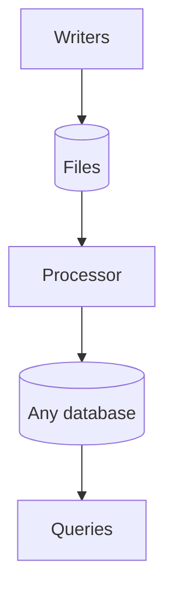
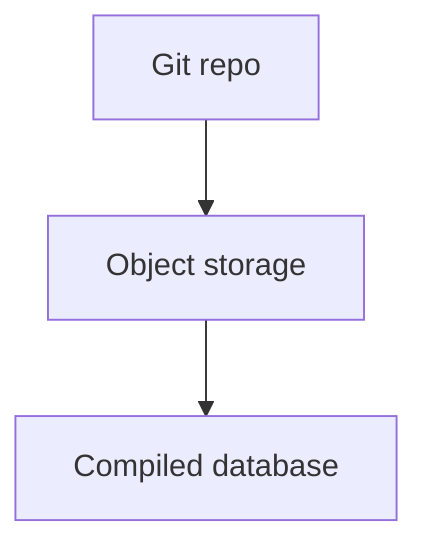

# Design

This document describes the whole system: what is stored, how writes and reads work, how models define data, and which optional patterns add stronger guarantees. The core idea comes first, then a worked example, then each part in detail.

## Contents

1. [The core idea](#the-core-idea)
   - [Goals](#goals) and [Storage stages](#storage-stages)
2. [Two worked examples](#two-worked-examples)
3. [Storage](#storage)
4. [File format and codecs](#file-format-and-codecs)
5. [Writes](#writes)
6. [Reads](#reads)
7. [Models](#models)
8. [Optional pattern: integrity](#optional-pattern-integrity)
9. [Optional pattern: one owner per account and sagas](#optional-pattern-one-owner-per-account-and-sagas)
10. [API](#api)
11. [Failure taxonomy](#failure-taxonomy-races-partial-failures-and-torn-reads)
12. [Fit and scale](#fit-and-scale)
13. [First use case: the LLC cap table](#first-use-case-the-llc-cap-table)
14. [Open questions](#open-questions)

## The core idea

**Human-readable files are the source of truth. Writing them takes almost no CPU or server work. Any database engine can then be built from them, which is where scale comes from.**

The system has three layers, and each layer has one job.



The diagram reads top to bottom. Writers are thin and only append and flush. Files in any S3-compatible store are the source of truth. The processor builds a derived, rebuildable database of any engine from them. Queries, APIs, spreadsheets, and reports read from that database.

1. **Files** hold the truth. A person can open any file in a text editor and read the history. All files are stored in any S3-compatible object store (a storage service that holds files and speaks Amazon's S3 protocol).
2. **Writers** do as little as possible. They check a request, append records to a file, and flush the file to the store. They keep no database and run no queries, so they need almost no CPU and no always-on server.
3. **Processing** turns files into whatever database engine the use case needs. Those databases are derived: delete one and rebuild it from the files. Queries, reports, and scale all come from this layer.

This split is why the same design fits very different projects. The files stay simple at every size. The only part that grows is the derived database, and it can be any engine you choose.

### Goals

YafiDB stands for "Yet Another File DB", a nod to YAML files. It has four core goals.

1. **Very easy for AI agents to spin up new projects.** A project is files plus model definitions. An AI can generate and read both, and there is no infrastructure to provision.
2. **$0 cost for most any project.** Small projects cost nothing to run or to leave idle.
3. **Infinite scaling through optional database writing.** Derived databases are opt-in. A project compiles one only when it needs to.
4. **Pluggable storage by stage.** The same files can live in a git repository, move to object storage, or be compiled into any database.

### Storage stages

Storage stages answer one question: where do the files live as a project grows? The files stay the same at every stage.



1. **Git repo.** The files live in a git repository, and each commit is an append. This is the starter stage for small projects. It is free, keeps history, supports pull request review, and is easy for AI agents to use. Its limits are write concurrency and repository size.
2. **Object storage.** The files move to S3-compatible object storage, with thin writers doing conditional writes. This is the path when write concurrency or size needs it.
3. **Compiled database.** A processor compiles the files into any database engine. It is optional and works with either of the first two stages.

### Range

The same core idea covers a wide range. Only the processing layer and the optional patterns change.

| Scale | Example | What it uses |
| --- | --- | --- |
| Weekend project | A guestbook or a recipe collection | Readable files, a thin writer, and a small SQLite file built on demand |
| Personal accounting | A household ledger and receipts | The same, plus a nightly export to a spreadsheet |
| Small business | The LLC cap table and equity tracking in this repository | The same, plus optional integrity checks |
| Banking | Accounts and money movement | The same, plus the optional patterns: signed hash chains, one owner per account, and sagas |
| Very large scale | A video site's channels, comments, and likes | The same, plus tiered derived databases and shared physical files |

### Optional patterns

Some use cases need stronger guarantees, such as money movement. This design offers optional patterns for them. They are not part of the definition of the system. A weekend project uses none of them.

- **Integrity:** hash chaining and signatures that make history tamper-evident. See [Optional pattern: integrity](#optional-pattern-integrity).
- **One owner per account:** a single writer per account, so two requests for the same account never run at once. See [Optional pattern: one owner per account and sagas](#optional-pattern-one-owner-per-account-and-sagas).
- **Sagas:** a way to make an action that touches several accounts finish completely or be reversed. Same section.
- **Tiered derived databases:** several layers of freshness for very large read loads. See [Reads](#reads).

### Why the records are YAML today

Every record file is YAML today. YAML was chosen for these reasons:

- **Human-readable.** People can read, review, and edit it without special tools.
- **Comments.** A person can leave notes in a file.
- **Appendable.** Several records can sit in one file as separate documents divided by `---`, so adding a record means adding to the end.
- **Markdown without escaping.** A `|` block holds Markdown, and embedded JSON, YAML, code, CSV, or HTML, exactly as typed.
- **Universal tooling.** Parsers exist in almost every language.

YAML is the current format, not a permanent commitment. Reading and writing go through a pluggable codec, so a future version can adopt another format, such as a YAML 2 or a format not yet invented. See [File format and codecs](#file-format-and-codecs).

## Two worked examples

All values here are illustrative. The first example uses only the core idea. The second adds the optional patterns.

### A weekend project: a guestbook

A visitor signs a guestbook on a small site.

1. **The request arrives.** A thin writer receives `{name: "Sam", message: "Nice site!"}`.
2. **The writer appends a record.** It adds one record to `guestbook/2026.yaml` and flushes the file to the store. It does nothing else.
3. **The store announces the new file.** A processor wakes, reads the changed file, and updates a SQLite database (a small single-file SQL database).
4. **The page loads.** It reads the latest entries from the SQLite file.

If the SQLite file is lost, the processor rebuilds it from the files. The files can be opened and read by hand at any time.

### Money movement: Alice pays Bob

Moving money needs stronger guarantees, so this example turns on the optional patterns. Alice has a balance of 500 units and sends 100 units to Bob.

1. **The request arrives** with an idempotency key, `req_7f3a`. This is a unique ID for the action, so a retry can never apply it twice.
2. **Alice's owner wakes.** The owner is a small writer that is the only writer for Alice's records. It checks her balance (500), sees the transfer is allowed, and queues the record `pending, -100, transfer t_881`.
3. **Bob's owner wakes.** It queues `+100, transfer t_881` in Bob's records.
4. **Alice's owner confirms.** It queues `confirm t_881`. If Bob's owner had failed, Alice's owner would queue `reverse t_881` instead.
5. **Each owner flushes** its queue to its own file in the store with a conditional write.
6. **The store emits events.** The processor wakes, reads only the changed batches, and updates the derived databases.
7. **Reads** now show Alice at 400 and Bob at 600. Until the processor finishes, the API adds each owner's pending changes on top, so Alice sees her own transfer immediately.

Both accounts end up with their own complete, signed record of the transfer. The shared ID `t_881` lets an auditor match the two sides.

The rest of this document explains each piece.

## Storage

Storage answers one question: where does the truth live, and what does it look like?

### Record files

The truth is a set of readable **record files**. They live in the current storage stage: a git repository for small projects, or an S3-compatible object store when write concurrency or scale needs it. A record file holds an append-only sequence of records. Records are only added, never edited in place, so a file reads as a history. Today each record is a YAML document, and one file holds several documents separated by `---`, which is standard multi-document YAML.

```yaml
---
format: yaml/1
---
id: rec_000001
seq: 1
schema: contribution@1
type: cash
amount: 5000
note: |
  Initial investment, wired 2026-01-05.
---
id: rec_000002
seq: 2
schema: contribution@1
type: time
hours: 12
note: |
  Built the first prototype.
```

The first document declares the file's format. See [File format and codecs](#file-format-and-codecs). The use case chooses how records are grouped into files. A common layout is one file per entity per period, such as `contribution/alice/2026.yaml`. The optional integrity pattern adds hashes and signatures to each record, which turns a file into a chain. See [examples/chains/](../examples/chains/) for full records with hashes and signatures.

### Freeform Markdown and embedded code

Any text field can use a YAML literal block scalar (`|`). Everything inside a `|` block is taken literally, so Markdown, JSON, YAML, CSV, HTML, and code need no escaping. This keeps notes and attachments readable.

````yaml
note: |
  ## Board decision

  We agreed to issue 1,000 new shares. The request payload was:

  ```json
  {"member": "alice", "shares": 1000, "memo": "line one\nline two"}
  ```

  And the config snippet:

  ```yaml
  vesting:
    cliff_months: 12
    total_months: 48
  ```

  ```ts
  const pct = (mine / total) * 100;
  ```
````

### Object store and the "S3 cannot append" problem

The store is any S3-compatible service. Cloudflare R2 is the first choice. At large scale the store can be your own S3-compatible storage placed near the processor.

S3-compatible stores cannot append to an object. To add a record, the writer rewrites the whole object. To make that safe, it uses a **conditional write**: it sends the object's version tag (ETag) in an `If-Match` header, and the store rejects the write if someone else changed the object first. The writer then re-reads and retries. For records that several writers might touch, the optional one-owner-per-account pattern makes such conflicts rare.

### File layout

Two rules keep files at a useful size.

- **Split by time.** Records are stored as one file per period, for example per year: `contribution/alice/2026.yaml`. This bounds the cost of rewriting a file. The size limit is a tuning choice, not a standard. A year per file suits low-write records like the LLC. Busier records can split by month.
- **No tons of tiny files.** Storage requests cost money and small objects are slow to list. At large scale, batches from many entities can share physical files, with an index recording which byte range belongs to which entity. A small deployment does not need this.

Each file name and path is stable and predictable, so any tool can find records without a database.

## File format and codecs

This section answers one question: how can the file format change later without breaking old data?

All files are YAML today. The format is pluggable, so a future version can adopt another one, such as a YAML 2 or a format not yet invented. The design supports this in three ways.

1. **Each file declares its format and version in a header.** The first document of every file says which format it uses, for example `format: yaml/1`. A reader looks at the header before it parses anything else.
2. **All reading and writing goes through a codec.** A codec is a small module with two jobs: turn a file's bytes into records, and turn records back into bytes. Writers, the processor, and the API never touch the file syntax directly. They ask the codec registered for the file's declared format.
3. **Switching formats is a new codec plus a migration.** A new format needs a codec that reads and writes it. Moving existing data to it is a migration that follows the same pattern as a schema migration: the migration script is deterministic and starts new files with a clear link to the old ones. Old files stay readable by their old codec, so nothing has to be converted before it is needed.

The header is the one thing every codec must be able to read, because it tells the reader which codec to use. Its exact syntax is an open question (see [Open questions](#open-questions)).

## Writes

Writes answer one question: how do changes get into the files with the least CPU and server work?

### The core write path

A writer does four things and nothing more.

1. **Check the request.** It validates the record against its model and checks the idempotency key.
2. **Queue the record.** It adds the record to a queue.
3. **Flush.** On an interval or when the queue reaches a size limit, it rewrites the file with the new records using one conditional write.
4. **Sleep.** It holds no database and runs no queries, so it can wake per request and cost nothing when idle.

A writer is stateless apart from its short queue. Any number of them can run, because the files and the store do the heavy lifting.

### Idempotency keys

Every action carries a unique idempotency key. Writers and the processor skip any key they have already applied. A retried request therefore never counts twice.

### Batching and the queue

Writing a whole object per record would be slow and costly. Writers instead **batch**.

- A writer keeps a **queue** of accepted records. The queue lives in the store (R2 or any S3-compatible store). A key-value store would be cheaper for some uses, but a store-based queue is portable and strongly consistent, so it was preferred.
- The writer **flushes** the queue into the file on an interval or when it reaches a size limit. The flush is a single conditional write.
- Records still in the queue are visible through the pending overlay (see [Reads](#reads)).

For use cases that need stronger guarantees, see [Optional pattern: one owner per account and sagas](#optional-pattern-one-owner-per-account-and-sagas).

## Reads

Reads answer one question: how do users query fast data that is built from slow, readable files?

Files are not queried directly. A processor builds a derived database from them, and queries run against that database. The database can be any engine, so scale is limited only by the engine you pick.

### Flush events

Each flush produces an object-created notification (for example, [R2 event notifications](https://developers.cloudflare.com/r2/buckets/event-notifications/), or a webhook on another S3-compatible store). The notification wakes the processor.

### The processor

The processor ingests **only the changed batches**.

- It **dedupes by batch ID**, so a duplicated event does nothing.
- It **orders by per-entity sequence number**, so out-of-order events still apply correctly.
- It runs a **periodic sweep** that lists the bucket and catches any batch whose event was missed.

For each new record, the processor validates it against its model, evaluates the CEL computed fields, and writes the results into the derived databases.

### Derived databases and optional tiers

The processor writes derived databases. A small project needs only one, rebuilt on demand. A very large read load can use **tiers**, from freshest to most settled.

| Tier | Holds | Why it exists |
| --- | --- | --- |
| Live | Changes from the last few seconds | Fast freshness |
| Hourly | Merged live changes | Keeps the live tier small |
| Daily | Merged hourly changes | Keeps hourly small |
| Base | Everything, compacted | Fast queries over all history |

The engine is the engineer's choice: Parquet, DuckDB, SQLite, a server database, a data warehouse, or any other engine. The tier names are a structure, not a requirement. The LLC runs a single tier rebuilt nightly.

These databases are effectively **precomputed API responses**. Most API reads become simple lookups.

### Complete snapshots only

Readers see only **published, complete** tiers. A tier is published after it is fully built, never while half-written. This prevents readers from seeing a half-applied update.

### Pending overlay

Because reads trail writes by seconds, the API can overlay a writer's pending records on top of the derived data. That gives **read-your-writes**: a user always sees their own changes at once.

### Full replay

Because the files are the truth, the processor can discard every derived database and rebuild from the files. The same replay serves audits.

### Exports to everyday tools

The raw files are not meant to be queried from SQL or a spreadsheet directly. Derived databases and exports provide that access.

- **SQL:** the derived databases are SQL-queryable (for example DuckDB or SQLite).
- **Sheets, Excel, and Drive:** the processor can write CSV or spreadsheet exports to a folder those tools read.

## Models

Models answer one question: what does a record look like, and what can be calculated from it?

Models are **language-neutral**. They use two open standards.

- **JSON Schema** describes fields: names, types, allowed values, and required fields.
- **CEL (Common Expression Language)** calculates derived values and, optionally, checks rules that involve more than one field. CEL is a small expression language from Google with mature implementations in Go, Java, C++, Rust, Python, and JavaScript.

An engineer can use JSON Schema validation, CEL checks, or both. The system supports both and does not force a choice.

### Where formulas live

Each formula sits on its own model, next to the fields it uses. Opening a model shows its fields and its math together, the way a spreadsheet column carries its formula. There is no shared file of unrelated formulas.

Derived values go in an `x-computed` keyword. Optional cross-field rules go in `x-validate`.

```yaml
# examples/models/contribution.model.yaml (abridged)
$id: contribution
type: object
properties:
  type: { enum: [cash, time, equipment] }
  amount: { type: number }
  hours: { type: number }
  hourly_rate: { type: number }
x-computed:
  slices: |
    type == 'time' ? hours * hourly_rate * 2.0
    : type == 'cash' ? amount * 4.0
    : amount
x-validate:
  - expr: "type != 'time' || (has(hours) && has(hourly_rate))"
    message: "Time contributions need hours and hourly_rate."
```

See the [full sample model](../examples/models/contribution.model.yaml).

### Related records stay pure CEL

CEL cannot define new functions. Instead, the engine passes related records in as variables. A member's formula can see `contributions` (this member's records) and `all_contributions` (everyone's).

```
size(contributions) == 0 ? 0.0
  : sum(contributions.map(c, c.slices)) / sum(all_contributions.map(c, c.slices)) * 100.0
```

CEL has no built-in `sum` over a list. The engine registers one small standard extension for it, the same way in every runtime. That keeps the formulas themselves in plain CEL.

### Why CEL is safe to run

CEL is built so an expression can only compute.

- It has no file, network, clock, or import access. An expression sees only the variables the engine hands it.
- It has no unbounded loops or recursion, so it always finishes.
- It is type-checked before it runs.
- It has no side effects.

It is an open specification with a shared conformance test suite, and it runs untrusted expressions in Kubernetes admission policies.

### Save-time checks

When a model is saved, the system does five things before accepting it:

1. Parse every CEL expression.
2. Type-check it against the declared fields.
3. Enforce a cost limit and a maximum expression length.
4. Run it against sample records.
5. Show a before-and-after preview of the affected totals.

A model change is itself a record, signed like any other if integrity is on. Git also records model files, so the history of the math is auditable in two places.

### Where formulas run

- **Official results run on the server**, using a mature, signed, pinned CEL implementation. Anything official, like a signed snapshot or a cap table export, comes from here.
- **Client-side JavaScript may evaluate the same CEL for display.** A client can fake what it shows to itself anyway, so display values need no extra trust. If two implementations ever disagree, that is a defect in an implementation, not a design problem.

## Optional pattern: integrity

Integrity answers one question: how can anyone tell that history was not changed?

This pattern is optional per data type. A ledger turns it on. A weekend project, or a feed of low-value records, leaves it off and keeps plain readable files.

### Hash chaining

With integrity on, each record carries its sequence number (`seq`) and the hash of the previous record (`prev`). The records in a file then form a **chain**. Changing any old record changes its hash, which breaks every link after it. This detects edits, deletions, and reordering.

### Signatures

Records are signed with **Ed25519**, a widely used public-key signature scheme.

- **The writer signs the chain wrapper.** The wrapper is the part that holds `seq`, `prev`, and the record's hash. The signature proves the system wrote it.
- **The user may also sign their own entry.** This proves the user asked for the action, and it is optional.
- **The signing key is kept separate from storage credentials.** Someone who steals store access cannot forge signed history.

An **index** can be turned on to make verification faster: a small file listing each file's last `seq` and head hash, so a verifier does not have to read every file to check the latest state.

### Schema versions and migration

Every record carries a schema version, for example `schema: contribution@1`. Old records stay valid under their old schema.

To change a schema in a way that needs rewriting history, the system uses a **migration**: it starts new files whose first record is a signed **genesis record** when integrity is on. The genesis record names the old chain and holds the old chain's last hash. The migration script is deterministic and reproducible, so anyone can run it against the old files and get the same new files. A change of file format follows the same pattern (see [File format and codecs](#file-format-and-codecs)).

## Optional pattern: one owner per account and sagas

This pattern answers one question: how do changes stay correct when many things happen at once, as with money?

It is optional. Use it when records have a clear owner and two requests for the same record must never run at the same time. A weekend project or a personal ledger with one user does not need it.

### One owner per account

With this pattern, each account has one **owner**: a small writer that is the only writer for that account. It handles one request at a time. That removes races inside the account by design.

- On Cloudflare, an owner is a Durable Object, which wakes on request and sleeps when idle.
- When self-hosted, an owner is a cell in [celld](https://celld.dev/).

The owner is per account, not per kind of action. Alice's account and Bob's account have different owners, so a million users means a million mostly idle owners. No single transfer worker has to handle everyone's traffic.

### Cross-account actions are sagas

An action that touches several accounts is a **saga**: a series of steps, each handled by one account's owner, tied together by a shared transaction ID.

1. **Pending.** The first owner checks its rules and records a pending change.
2. **Apply.** Each other owner records its own side of the change.
3. **Confirm.** The first owner records that all sides succeeded.
4. **Reverse.** If any step fails, a reversing record undoes the earlier steps.

A progress log lets a crashed saga resume. Readers treat pending entries as not final. Every account keeps its own complete record, and the shared ID lets an auditor match the sides.

The same pattern covers three-way trades, bill splits, and account merges. At each step that needs to block conflicts, the owner for that account serializes the check.

### Hot accounts

A very busy single account is a one-at-a-time bottleneck. The fix is to split it into sub-accounts, the way banks use omnibus accounts. This is rare, and the extra load stays with that one account.

## API

The API is built with [Hono](https://hono.dev), which runs on Cloudflare Workers, Bun, Deno, Node, and celld, so the same code moves between hosts.

- **REST comes first.** Routes are generated from the models. REST caches simply and is the easiest to get right.
- **GraphQL is an optional later layer** on the same derived databases. It would not change storage or models. It brings known costs: nested queries can cause one lookup per item, so it needs batching (DataLoader style), depth and cost limits, and saved queries to restore caching. GraphQL mutations would pass through the same owners and sagas.

## Failure taxonomy: races, partial failures, and torn reads

Three different problems can corrupt data. They have different fixes, so naming them separately matters. The fixes in the table below come from the optional patterns, so use them where a use case needs them.

| Problem | What happens | Fix in this design |
| --- | --- | --- |
| **Race** | Two actions run at once and both pass a check | A single owner per account serializes them (optional pattern) |
| **Partial failure** | An action does some steps and then stops | Sagas with reversals, plus idempotent retries (optional pattern) |
| **Torn read** | A reader sees an update half applied | Complete published snapshots and chained records |

### Examples

**Race: double spend.** Alice has 100 units. Two requests to send 100 units arrive at once. Without an owner, both read "100" and both pass. With one owner for Alice, the second request waits, sees 0, and fails.

**Race: duplicate username.** Two people claim `river` at the same moment. The username has a single owner, so one wins.

**Partial failure: two-party transfer.** Alice's debit is written and then Bob's credit fails. The saga writes `reverse t_881` on Alice's chain.

**Partial failure: three-party trade.** Alice gives shares to Bob, Bob gives cash to Carol, and Carol gives a license to Alice. Each leg is a step under one transaction ID. If the third leg fails, the saga reverses the first two in reverse order. The progress log lets a crashed coordinator resume instead of leaving one leg dangling.

**Partial failure: bill split among four.** One payer is charged and three others owe shares. Each of the four accounts records its own side under the same ID. If one fails, all sides reverse.

**Torn read: cap table total.** A transfer moves 10% of the shares from Alice to Bob. A reader sums holdings between the debit and the credit and sees 99.9% or 110%. Readers only see complete published snapshots, so the total is always 100%.

**Torn read: pending saga.** A reader sees `pending -100` on Alice but no matching credit on Bob. Readers treat pending entries as not final and exclude them from official totals.

## Fit and scale

### What fits

- Records that change rarely per entity and have a clear owner: ledgers, profiles, posts, ownership, follows, contracts, comments, and messages.
- **Likes** work as per-user facts, with aggregated counts that tolerate a few seconds of delay.

### What does not fit

- Firehose streams such as access logs and telemetry. Use a purpose-built pipeline.

### Scale notes

- **Writes stay cheap at every size.** A write is an append and a flush, so there is no database on the write path. Adding entities adds files, not load on one database.
- **Reads scale with the engine you choose.** Derived databases are read-only, can be rebuilt from the files, and can be copied or cached. Moving to a bigger engine means re-running the processor, not changing the files.
- **Request cost is the pressure point.** Rewriting objects and listing the bucket cost money per request. Batching, time-split files, and shared physical files keep that bounded.
- **At large scale,** use storage you control near the processor, shared physical files for many entities, and the full tier set.

### Thought experiment: a video site like YouTube

Consider the records of a video site, not the video bytes.

- **Channels, profiles, subscriptions, and video metadata** are owned, low-write records. They fit well.
- **Comments** are owned records with modest write rates. They fit.
- **Likes** fit as per-user facts, with counts aggregated by the processor.
- **View counts and watch-time telemetry** are firehose data. They do not fit and belong in a streaming pipeline.
- **The video files themselves** sit in object storage and are referenced by the records.

The design handles the owned records and leaves the firehose to the right tool.

## First use case: the LLC cap table

The first use is Jonathan's LLC, which is migrating off Coda. It needs two things:

- A **cap table** of shares, changed about monthly.
- A **Slicing Pie** record of investments and labor, written about daily. (Slicing Pie is a method for splitting equity in an early company in proportion to what each person contributes.)

The setup:

- **One owner** for the cap table (optional pattern).
- **Three models:** member, share transaction, and contribution, each with CEL formulas for derived values like slices and percentage of the pie.
- **Signed, hash-chained** record files in R2 (optional integrity pattern).
- **A nightly processor** rebuilds all derived data. At this volume, tiers add nothing.
- **A static site on Cloudflare Pages behind Cloudflare Access.** Cloudflare Access does the sign-in, so no middleware is needed.
- **Cost:** $0 while idle.

This is the same core idea as the large version, with a single owner and a single tier.

## Open questions

- **File header syntax:** the exact form of the format header (for example `format: yaml/1`) so that every codec can read it before it knows the format.
- **Index format:** the exact layout of the optional chain index and of shared physical files at scale.
- **Key rotation and revocation:** how signing keys change over time and how old signatures stay verifiable.
- **Schema upgrade strategy:** versioned schemas with upgrade-on-read versus new chains by migration, per data type.
- **Choice of CEL implementations:** which mature server-side implementation to pin first, and which JavaScript port to use in the browser.
