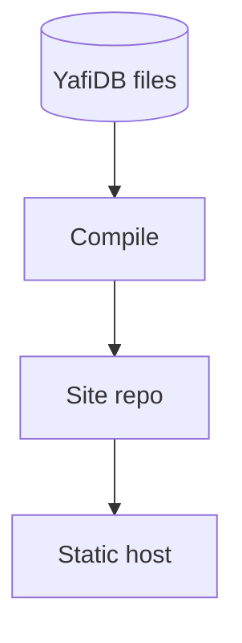

# A fully static website from YafiDB files

This guide explains how to publish a website that is built entirely from YafiDB files, with no database or server running when a visitor loads a page. It is guidance only. No code exists yet, and all names and values are illustrative.

## The idea

You store your records as YafiDB files. A compiler turns those files into a complete static website: ordinary pages, styles, and data that any web host can serve. The compiler then commits the generated site to a git repository. A static host publishes that repository.

Visitors only ever load static files, so the site is fast and cheap to host. A small worker handles the rare case when something changes.

## How the pieces fit

The files stay the source of truth. The compiler reads them and writes the generated site into a repository. The static host publishes whatever is in that repository. GitHub Pages, Cloudflare Pages, or any other static host can do this.

## A worked example: a recipe site

All values here are illustrative.

1. **The records live as files.** Each recipe is a record in a YAML file in S3-compatible storage.
2. **A visitor loads the site.** They get plain pages from the static host. No worker runs.
3. **Someone adds a recipe.** A request goes to the small worker, which appends the record to the files. This is the only time a worker is involved.
4. **The compiler runs.** It reads the changed files and regenerates the site, including the new recipe's page and the updated index.
5. **The compiler commits the generated site** to the site repository.
6. **The static host publishes the commit.** Visitors see the new recipe.

## What goes where

- **The YafiDB files** hold the records. They are the only place data is edited.
- **The site repository** holds the generated site only. People do not edit it by hand, because the next compile overwrites it.
- **The small worker** accepts changes and writes them to the files. It does not serve pages.
- **The static host** serves the repository's contents.

Git is used here only as the place the generated site is published from. The records themselves stay in the storage you configured.

## Choices to make

- **Which host.** Any static host that can publish from a git repository works.
- **When to compile.** Compile when the files change, or on a schedule. Compiling when files change keeps the site current. A schedule is simpler and cheaper for sites that change rarely.
- **How much to regenerate.** The compiler can rebuild the whole site every time, or only the pages whose records changed. Rebuilding everything is simpler and is fine for small sites.

## Related

- [Configuration](configuration.md) explains the compile setting.
- [Design](design.md) explains the files, the worker, and the optional features.
