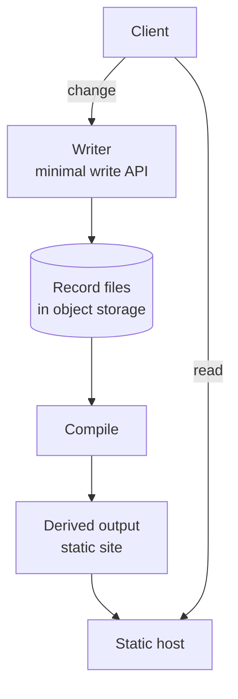

# A static website with optional workers

This guide explains how to publish a website that is built entirely from YafiDB files, with no database or server running when a visitor loads a page. It is guidance only. No code exists yet, and all names and values are illustrative.

## The idea

You store your records as YafiDB files. Compile turns those files into a complete static website: ordinary pages, styles, and data that any web host can serve. A static host then serves the result.

Visitors only ever load static files, so the site is fast and cheap to host. Changes can come in one of two ways:

- **Git only.** Records are YAML files in a Git repository. You create and edit them with a local YafiDB tool, which checks each record against its schema. The build runs as a test in the repository, so a bad record fails it. The Git host, such as GitHub or GitLab, builds and publishes the site on each push. No write API runs, so there is no write surface beyond the Git host. This suits sites that change rarely, because each change is a commit. Git history shows who changed what. Authorship is verified only when commits are signed.
- **Optional workers.** A minimal write API, run as a few small workers, accepts changes such as form submissions. Each writer validates the record, signs it, and adds it to storage. The site is then rebuilt and redeployed. Writers handle only writes, and visitors never reach them.

## How the pieces fit

Changes and reads take separate paths. A change goes through a writer, into the files, and through compile to the site. A read goes straight to the static host and never touches a writer or the files.

The files stay the source of truth. Compile reads them and builds the derived output, which is the generated site. The build can run in CI, or YafiDB can commit the generated site to a publish repository. Either way, the static host publishes it. GitHub Pages, Cloudflare Pages, or any other static host can do this.

In Git-only mode there is no writer. The repository holds the records, and the Git host builds and publishes on each push.

## A worked example: a recipe site

All values here are illustrative.

1. **The records live as files.** Each recipe is a record in a YAML file in object storage.
2. **A visitor loads the site.** They get plain pages from the static host. No writer runs.
3. **Someone adds a recipe.** A request goes to a writer, which checks the recipe against its schema, signs it, and adds it to the file. This is the only time a writer is involved.
4. **Compile runs.** It reads the changed files and regenerates the site, including the new recipe's page and the updated index.
5. **The build publishes the generated site.** CI deploys it, or YafiDB commits it to a publish repository.
6. **The static host publishes the new site.** Visitors see the new recipe.

## What goes where

- **The record files** hold the records. They are the only place data is edited. In Git-only mode, the Git repository holds them.
- **The derived output** is the generated site. People do not edit it by hand, because the next compile overwrites it. A publish repository, if you use one, holds only the generated site.
- **The writer** accepts changes and writes them to the files. It does not serve pages. Git-only mode has no writer.
- **The static host** serves the generated site.

Git holds the records in Git-only mode. In optional-workers mode, the records stay in the storage you configured. Git can also hold the generated site, when YafiDB commits it to a publish repository.

## Choices to make

- **Which host.** Any static host that can publish from a git repository works.
- **Git only or workers.** Git only suits sites that change rarely. Use optional workers when you need a write API, such as for form submissions.
- **When to compile.** Compile when the files change, or on a schedule. Compiling when files change keeps the site current. A schedule is simpler and cheaper for sites that change rarely.
- **How much to regenerate.** Compile can rebuild the whole site every time, or only the pages whose records changed. Rebuilding everything is simpler and is fine for small sites.

## Related

- [Configuration](configuration.md) explains the storage, derived output, and writer settings.
- [Design](design.md) explains the files, the writer, and the optional features.
